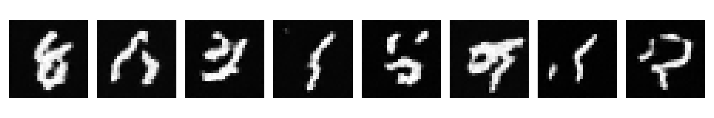

## **一、S1 第一至二周验收结论**

验收日期：2026 年 10 月 30 日；基线提交：`781c90f`。结论：**DDPM、VAE 个人核心数学与有限范围工程验收通过；S1 暂不作整阶段完成登记。** 仍需补齐 Notebook 的干净顺序执行证据、第二周新增实验汇总、过时测试与接口说明，以及个人理解验收。

本次没有改写源码、测试或原 Notebook，没有下载资源或重新执行两周正式长训。只运行数学测试、既有 Checkpoint 的推理/评测，以及临时目录内的 8 步 CPU 工程验收；验收执行时只新增本报告及证据，后续按用户要求单独提交验收产物。数据、权重和原始日志均留在原位置，新增短训文件位于 `/private/tmp/minigen_s1_acceptance`。

机器可读证据：[验收 JSON](s1_acceptance_2026-10-30.json)。以下“通过”有明确范围，不代表所有边界、开放域质量或用户理解均已证明。

### **1. 按原任务逐项判定**

| 任务 | 判定 | 实际依据与未完成边界 |
| --- | --- | --- |
| S1-01 研究与范围 | 通过（文档部分） | 研究目标、双路线、资源与数据隔离已明确，不评价未发生的后续研究结果 |
| S1-02 环境与训练工程 | 通过（现有接口范围） | 项目环境可导入，训练、采样、日志与恢复工具实际工作；CLI train/sample/evaluate/cache 仍未实现 |
| S1-03 DDPM | 代码通过；理解基本通过 | 独立数学与完整采样通过；后续答题正确说明输入、目标及索引，需补齐随机时间的期望估计解释 |
| S1-04 MNIST 小模型闭环 | 教学闭环通过；个人核心推理兼容通过 | 既有1000步训练和EMA权重可用；本次未重新把千步正式训练改标为个人核心训练 |
| S1-05 中断恢复 | 范围内通过 | 全套已有恢复测试外，新增个人VAE连续8步与3→8恢复逐位对照；旧MNIST训练Checkpoint没有随机loader游标，不保证其精确恢复 |
| S1-06 VAE | 两项个人数学核心与小步工程通过 | 闭式KL、标准差、归一化、梯度均正确；五组既有权重可用个人函数评测；文档/测试状态待同步 |
| S1-07 脱稿解释与复盘 | 已答题，部分通过 | DDPM与重参数化基本掌握；KL口述符号及聚合统计需纠正，一页阶段复盘仍待验收 |

## **二、已经通过的代码与实验**

### **1. DDPM 个人核心**

运行 `scripts/check_ddpm_core.py` 通过：手算前向最大误差1.19e-7，独立高斯后验、直接噪声参数化反向均值和梯度对照通过，经验分布每时间级别32768样本通过统计容差，最终步不加随机噪声。

本次使用 `artifacts/runs/s1_week1/mnist_short/latest.pt` 的既有 EMA 权重，显式传入 src `DDPMScheduler(num_steps=1000, clip_denoised=True)`，以初始种子41、反向种子42在MPS上生成8张。全部完成1000步/1000次求值，耗时约5.08秒，数值有限。**权重的原训练来源仍是 notebook_reference**，只将本次调度器来源记为 project_core。



目视可见多张数字笔画，也有混淆和结构异常；没有新增分类器，不报告数字准确率或高质量生成达标率。

### **2. VAE 个人核心**

`reparameterize` 正确使用 log variance 的一半再指数化；KL 正确计算近似后验对标准正态，非 batch 维求和、batch 平均。原 `scripts/check_vae_core.py` 通过，另在 `[1,1]`、`[2,3]`、`[2,3,2,2]` 三种形状上，与 Torch 分布 KL 独立对照并做双精度 gradcheck，最大 KL 误差8.88e-16。

从真实 MNIST 训练划分取19图、batch7、验证7图，显式使用这两项个人函数进行CPU小步验收：连续8步与先3步再恢复到8步，模型、Adam状态、Torch/Python/NumPy RNG、数据排列和游标完全一致。参数实际更新，验证重建代理损失约544.69→431.11；这是接口/恢复检查，不是生成质量结论。

### **3. 数据与五组既有 VAE 权重复验**

本地MNIST四个资源SHA-256均与清单一致，训练10000与验证1000索引互斥，测试集未参与。验证时直接读取已存在数据，不调用会下载和重写清单的准备入口。

下表是本次用个人核心在1000张验证图上重新评测的结果，已有权重来源仍标 notebook_reference；重建为逐图像素BCE求和后平均，KL为逐图潜维求和后平均。

| 模型 | 已有更新步数 | 随机重建BCE/图 | 均值重建BCE/图 | KL/图 |
| --- | ---: | ---: | ---: | ---: |
| d16_beta0 | 1000 | 97.099 | 97.096 | 345.275 |
| d16_beta05 | 1000 | 105.667 | 101.871 | 23.329 |
| d16_beta1 | 1000 | 114.561 | 109.264 | 15.528 |
| d16_beta4 | 1000 | 143.709 | 132.648 | 5.522 |
| d2_beta1 | 1000 | 156.953 | 155.764 | 5.125 |

实际查看了当前重建和先验样本图：较强KL伴随更模糊的重建，无KL先验输出较混乱；这是当前单种子教学结果。不同维度组不作只改变KL权重的对照，灰度soft-target BCE不解释为精确连续图像似然。

## **三、整阶段交付仍需收尾的事项**

### **1. 第二周部分运行分支有一处真实错误**

位置：[第二周 Notebook](../../docs/learning/S1_第2周_VAE原理与潜空间实验.ipynb)，零起始第64单元（第65个单元）的 `common_step` 计算。

新增 beta=0.5 后，共同对照读取四个 d16 配方，但保护条件仍是 `len(runs) >= 3`。若只完成 beta0、beta05、beta1，条件成立，随即读取不存在的 beta4，抛出 `KeyError: 'd16_beta4'`。本次以三组已完成状态单独执行该赋值语句，确实复现；不是说既有完整五组实验发生了该异常。

需要按“全部需要的名字都存在且拥有可比较Checkpoint”判断，或者对实际完成组明确降级报告。不能仅调整数量阈值后继续假定所有文件都存在。

### **2. 当前 Notebook 缺少干净顺序执行的完整证据**

| 文件 | 当前代码单元 | 有执行计数 | 状态 |
| --- | ---: | ---: | --- |
| Week1 | 25 | 21 | 4个空计数，含数据、正式训练和采样单元；执行编号非顺序 |
| Week2 | 18 | 18 | 存在回退和跳号，不能视作本版本从干净内核顺序执行 |

两份文件均通过nbformat和代码编译，当前没有error输出，既有日志/权重也证明发生过真实训练。因此本条 **不等于已经证明Notebook不能运行**；它说明修改后的交付版本尚缺干净内核复验依据。本轮没有覆盖你的学习执行现场或重跑整份训练。

Week1学习格式检查还有5处新增调试说明的标题形式问题；Week2格式结构检查通过。是否保留调试单元由你决定，但交付版本应在干净内核顺序执行并重新核对结果来源。

### **3. 新实验、测试和说明尚未同步**

- 第二周 Notebook、图像与实际目录已有 d16_beta05 的1000步结果；`reports/stage1/week2_results.json` 和历史报告仍只汇总原四组。应保留旧报告日期与历史语境，另登记新增结果，不能只在源代码添加一行配方就认为报告已更新。
- 完整 pytest 为88通过、2失败：`test_remaining_core_interfaces_never_silently_fall_back` 和 `test_project_core_still_explicitly_pending` 仍要求VAE抛待实现异常。失败来自过时断言，不是本次数学检查发现VAE错误。应换成个人核心正向验收，并保留DiT/CFG/Flow的学习边界。
- `vae_core.py` 两个函数仍写“预留/当前不返回”，缺少Results；还有未使用pending导入、导入顺序和格式问题。不能在已返回有效结果时继续保留未实现文案。
- `TinyVAE.decode` 新增形状检查实际抛ValueError，现有Raises仍只写RuntimeError；两份VAE源码的Ruff/格式检查尚未全过。
- 第一、二周旧教学报告中的“src核心未实现”属于历史快照；当前验收已确认DDPM和VAE个人代码正确，需要通过新的状态登记说明当前事实，不能自动将历史教学训练改标为个人实现训练。

## **四、验收依据与下一步**

### **1. 本次实际运行**

```bash
uv run --locked --extra notebook --extra latent python scripts/check_ddpm_core.py
uv run --locked --extra notebook --extra latent python scripts/check_vae_core.py
uv run --locked --extra notebook --extra latent pytest -q
uv run --locked --extra notebook --extra latent python scripts/check_code_annotations.py
```

另运行临时CPU工程/Checkpoint评测脚本和MPS完整采样脚本，结果保存在验收JSON。抽查VAE的ELBO两条推导、重参数化梯度、KL归一化及损失语义；没有逐行审定所有学习笔记，也没有重新做全页浏览器渲染验收。未使用收费资源。

### **2. 最短收尾路径**

先修复共同步数的部分运行保护与旧测试/接口文档，再在副本或备份后顺序复验两份笔记、更新新增beta=0.5结果，最后完成个人解释与阶段复盘。S1-03与S1-06的代码部分可以据此登记“已验证”，整阶段与S1-07暂不勾选。

本次验收只新增报告、结构化证据及一张推理复验图，没有修改实现或原笔记；后续提交范围仅为这三项验收产物。

## **五、个人理解答题反馈**

本节依据用户随后提交的三项回答更新，不改变此前代码验收结果。理解验收记为 **部分通过，需纠正关键概念**，不因收到回答就直接勾选整个S1。

### **1. DDPM：基本通过，补齐抽样目标的解释**

输入是带噪图像与时间，网络直接预测构造该输入时所用的标准噪声；代码索引0已经经过一次加噪，这些回答正确。注意这里的目标是闭式构造中的累计标准噪声，不必等于逐步前向链中某一次独立的单步噪声。

前向闭式解决“怎样直接生成任意时间的输入”，随机抽时间可以训练还因为目标本身是时间平均：

$$L(\theta)=\frac1T\sum_{t=1}^T\mathbb E_{x_0,\epsilon}\!\left[\lVert\epsilon_\theta(x_t,t)-\epsilon\rVert_2^2\right]$$

均匀抽取时间并计算该项损失，是这个平均目标的Monte Carlo估计。网络参数在不同时间之间共享，不需要每次更新遍历所有时间。

采样时下一个输入依赖当前反向更新，所以依次走链。在当前实现中，网络只输出噪声，干净图像估计由公式反算，不是第二个独立网络输出。其他等价参数化可以直接写出反向均值，不一定在代码里显式构造干净图像估计。

### **2. VAE：标准差与采样通过，KL的口述符号需纠正**

使用对数方差的一半再指数化得到标准差，这一点正确。样本为 $1+\sqrt4\times0.5=2$，也正确。

近似后验对标准正态的KL应为：

$$D_{\mathrm{KL}}\big(\mathcal N(\mu,\sigma^2)\Vert\mathcal N(0,1)\big)=\frac12\left(\mu^2+\sigma^2-1-\log\sigma^2\right)$$

> 本题代入为 $\frac12(1+4-1-\log4)=2-\log2\approx1.3068528194$，不是 $2+\log2$。关键是对数项前的减号。

减号来自KL中的后验对数密度项：高斯熵含正的对数方差，KL是相对标准正态的交叉熵减去后验熵。已经验收的个人代码中用的是正确减号；本次是回答时写反，不应把正确代码改成加号。

### **3. KL权重与统计口径：部分通过**

回答已经抓住重建与正则的取舍。增大权重常使后验更接近先验，同时可能牺牲重建；这不是有限训练下的绝对单调保证。训练中没有独立定义的“先验采样损失”，KL下降也不保证先验样本质量提升。过强约束可能使潜变量失去输入信息，出现后验坍塌或模糊重建。

“均值和方差接近0与1”要区分两种口径：

- 若每张图的对角高斯后验参数都接近0与1，其对标准正态的KL确实小；但编码可能几乎不携带图像信息，重建与生成质量仍不能由此保证。
- 若只是整个数据集的聚合潜变量均值为0、方差为1，只匹配了两项统计，不能据此判断完整分布是标准正态，也不能推出逐图后验的KL小。

> 例如一半图像的后验为 $\mathcal N(-0.8,0.36)$，另一半为 $\mathcal N(0.8,0.36)$。聚合均值为0，方差为 $0.36+0.8^2=1$，却是两个高斯的混合。每个后验对标准正态的KL为 $-\frac12\log0.36\approx0.510826$，并非零。

总损失、重建、逐样本KL、聚合统计和真实先验样本应分别观察，不能用任何一个指标单独替代生成质量。当前需要巩固KL符号、抽样目标和统计口径；S1-07的一页阶段复盘仍未取得证据，整阶段状态保持未完全通过。
