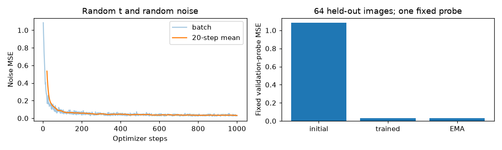
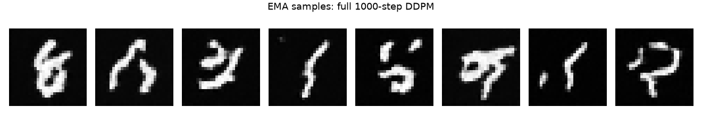
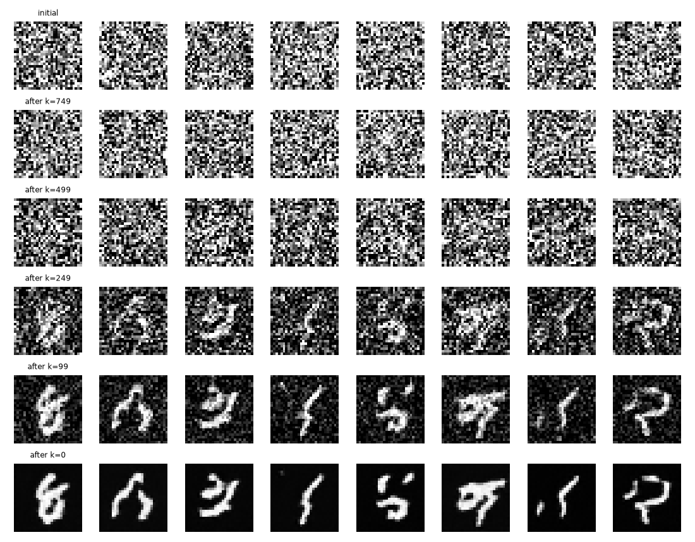

## **一、第一周实际交付与完成边界**

执行日期：2026 年 10 月 24 日。用户选择提前开始第一周任务；原日历的周一目标不改变本次实际日期。知识交付为 [DDPM 原理与 MNIST Notebook](../../docs/learning/S1_第1周_DDPM原理与MNIST实验.ipynb)，包含全流程、必要概率概念、前向递推、后验配方、变分目标、完整教学核心与真实实验。

唯一完整 DDPM 教学参考定义在 Notebook 中，由训练器显式接收。src 的 DDPM 和其他四项核心保持未实现，原边界测试仍通过；没有自动 fallback。项目 CLI 的 train、sample、evaluate、cache 继续明确报错。

### **1. 本次执行设置**

| 项目 | 实际设置 |
| --- | --- |
| Python / PyTorch | 3.12.14 / 2.14.1 |
| 设备与精度 | Apple MPS，float32 |
| 数据 | 官方 MNIST 训练部分中固定选 10000 训练、1000 验证；官方测试未参与 |
| 网络 | TinyUNet，base=32、时间宽度 128，654785 参数 |
| 噪声过程 | 1000 步，线性 beta 0.0001→0.02，反向采用后验方差 |
| 优化器 | AdamW，学习率 0.0002，weight decay=0，batch 64 |
| 梯度与 EMA | 梯度范数裁剪 1，EMA 衰减 0.99 |
| 训练种子 | 20261026，单次训练 |
| 采样 | EMA 权重，新初始噪声种子 41，反向噪声种子 42，8 张图 |
| 运行边界 | 拟合、训练和采样合计约 30 分钟上限；无云资源或额外模型 API |

## **二、数据来源、校验与隔离**

使用 Torchvision MNIST 官方加载器，四个压缩资源通过其 MD5 校验，额外保存 SHA-256。加载器同时下载了训练和测试文件，但本次只读取官方训练部分，测试文件没有用于训练或选型。原始与解压文件实测占用 66544770 字节，约 66.54 MB。

10000 张训练和 1000 张验证索引互不重叠，划分指纹为 `caae80b4d0f9cc96b9761366f6d22d0597677efdd880dd86d6837ec3312fbde9`。原始资源、索引及变换记录在忽略目录 data/manifests/mnist_week1.json。

MNIST 本周沿用官方 IDX 文件与索引 JSON，不强行转换成逐图 PNG；后续图标数据继续采用逐图 JSONL 规则。图像为 1×28×28，映射至 [-1,1]，类别标签只用于展示真图，不作为模型条件。

## **三、数学、工程与执行验证**

- Notebook 从干净项目内核顺序执行，17 个代码单元全部保留执行计数与真实输出，无 error 输出，包含 7 幅内嵌图。
- 前向分布的解析均值方差与 NumPy 统计对照通过；后验与独立标量精度配方对照通过。
- 广播、时间边界、最终一步噪声不影响结果、损失梯度及反向抽样统计检查通过。
- 已知真噪声的解析恢复最大误差约 2.38e-7；这是公式验证，不是网络生成能力。
- 14 项 pytest 检查通过，包含 U-Net 时间梯度、核心未实现边界、完整采样与超时区分、教学后验与独立计算。
- CPU 固定单批次下，连续 6 步与 3 步保存后恢复到 6 步的模型及 EMA 参数逐位一致；未实现随机 DataLoader 的中途顺序重放。

Notebook 后续做过不改变计算 AST 的格式整理，执行输出与计数逐项保留；只排序导入、删除未使用导入，并补充数学解释和结果分析。不会用重新填写输出冒充运行。

已导出 HTML，在实际浏览器抽查首页表格及变分目标公式，长公式分行显示；7 张内嵌图全部成功加载。另直接查看生成样本图；这是代表性视觉抽查，不宣称逐页完整视觉验收。

## **四、真实短训与样本观察**

### **1. 量化记录**

| 实验 | 步数与耗时 | 实际结果 | 能证明什么 |
| --- | --- | --- | --- |
| 固定 16 图、时间与噪声拟合 | 100 步，约 6.47 秒 | 固定 MSE 1.07711→0.00998 | 网络与优化链能拟合指定映射 |
| 随机噪声与时间训练 | 1000 步，约 106.11 秒 | 固定 64 图验证探针 MSE 1.08173→0.03204；EMA 0.03137 | 独立固定探针改善，尚非完整质量评测 |
| 完整 DDPM 采样 | 1000 次模型调用，约 11.80 秒 | 8 张图全部完成，未跳步；估计干净图裁剪至 [-1,1] | 完整教学生成链可运行 |
| 整个本地实验段 | 约 133.73 秒 | 在约 30 分钟预算内 | 不含数据下载、环境安装及文档制作 |

前后探针使用相同图像、噪声和时间，便于比较；它只有 64 张图、一个扰动设置，不能当作完整验证集平均指标。EMA 本次略低，不据此推断普遍显著收益。

### **2. 全批次样本与失败分析**

观察完整 8 张：已经出现竖直、弯曲和闭合的笔画，有几张具有明显数字形态；仍有笔画黏连、形状变形、零散亮点和语义不明确的图。没有逐图目标真值，因此不把猜测的类别当成准确率。

| 实际现象 | 当前证据与可能原因 | 下一步怎样验证 |
| --- | --- | --- |
| 笔画黏连或多个结构混在一起 | 样本可见；短训可能尚未建立稳定整体结构，但不能仅凭图像定因 | 用户核心接入后，在固定噪声与相同配置下比较更多训练步的 Checkpoint |
| 局部亮点、细线或边缘不稳定 | 样本可见；原图范围和数学对照已检查，仍需区分权重与采样因素 | 固定权重比较原模型/EMA，记录可见缺陷与完整轨迹 |
| 一些形状难以辨认，覆盖范围未知 | 只有 8 图、一个训练种子，不能判断类别覆盖或稳定性 | 预先固定更多提示条件之外的噪声种子，做更大人工样本审计与近邻检查 |

这里给的是待验证的假设，不宣称已经完成因果归因；本轮没有为追求更好图片额外扩大训练。

中间状态由同一条完整反向链截取，不是用跳步生成的中间图。显示为了可读性裁剪像素范围；实际状态计算仍由采样器和配置决定。

## **五、任务状态与下一份动手任务**

| 任务 | 当前状态 |
| --- | --- |
| S1-01 研究与证据规范 | 原规划与本报告已明确学习问题、两条路线、费用和证据边界；理解仍由用户验收 |
| S1-02 工程基础 | U-Net、数据、训练日志、EMA、Checkpoint 与可执行 Notebook 教学闭环已验证；CLI 和项目核心接入另列 |
| S1-03 用户 DDPM 核心 | 教学推导和参考通过；src 主体仍待用户亲手完成，不勾选整体完成 |
| S1-04 MNIST 基线 | 教学短训、固定拟合与完整采样完成；项目核心接入及用户复盘仍待完成 |
| S1-05 恢复 | 固定 CPU 单批次的基本对照通过；随机数据顺序恢复未验证 |
| S1-06、S1-07 | VAE 与整个阶段验收留到后续，不提前完成 |

下一步阅读 Notebook 第二至六章，合上答案实现自己的 add_noise、loss、step，再通过独立数学测试接入同一训练工程。任务入口见 [learning/README.md](../../learning/README.md)，笔记导航见 [docs/learning](../../docs/learning/README.md)。

## **六、复现与已知限制**

运行方式见学习导航。完整结构化结果、资源哈希、源文件指纹与代码基线见 [week1_results.json](week1_results.json)。基线加本轮源码改动共同构成本次实验，不能说初始 Git 提交本身已包含训练工程。

权重、原始数据和详细日志在忽略目录；报告保留必要小图，Notebook 保留内嵌输出。仅做一个训练种子，8 张采样与固定 64 图探针，无 FID、类别覆盖、记忆风险或开放域能力结论。源码核心保持用户所有，未自动提交或推送本轮改动。
