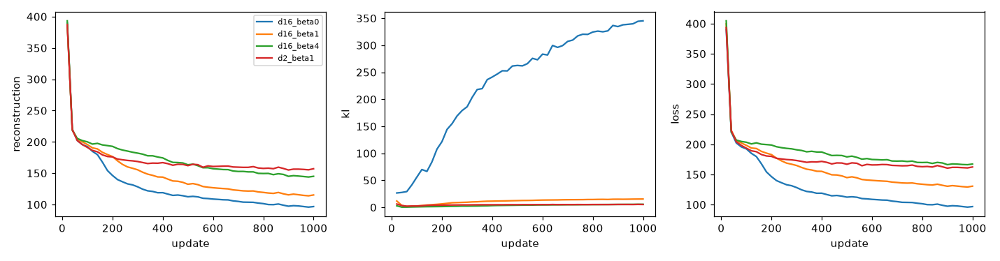
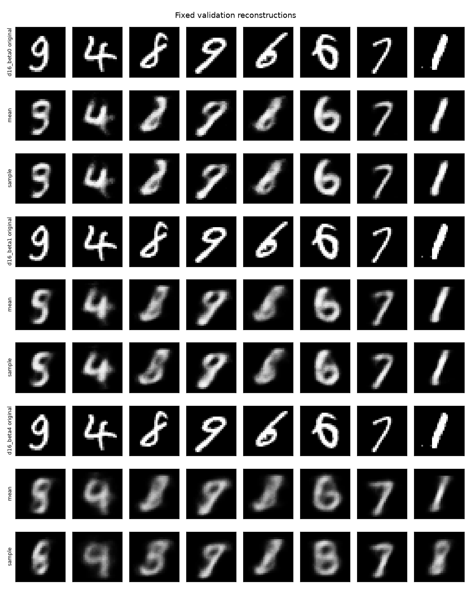
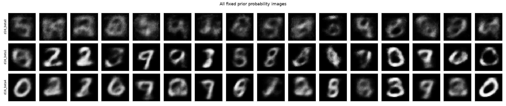

## **一、S1 第二周交付与证据边界**

实际执行日期：2026-10-24，按用户授权提前推进第二周；原规划日历不伪装成实际执行日期。知识交付为 [VAE 原理与潜空间 Notebook](../../docs/learning/S1_第2周_VAE原理与潜空间实验.ipynb)。本报告由真实记录和图像复核形成，不是预期结果。

Notebook 提供唯一的完整教学核心，显式标为 notebook_reference。src 的 VAE、DDPM 等五项核心保持未实现；个人实现及理解验收仍为待做。第一周 Notebook 和五项核心基线哈希保持不变。

## **二、数学、数据与实验设置**

### **1. 知识与来源覆盖**

Notebook 共 12 章：整体生成流程、概率基础、Jensen 与后验 KL 两条 ELBO 推导、一维到多维高斯 KL、重参数化路径梯度、网络与目标、真实实验、恢复、潜空间扩散桥梁及自测答案。每个标题独立为 Markdown 单元。

主来源是 VAE 第 2–3 节及附录 B/C；DDPM 用于复习与变分模型比较；LDM 第 3.1–3.2、4.1 节用于表示压缩桥梁。原文、固定版本与阅读卡见 [论文目录](../../docs/papers/README.md)，不是以这三篇代表全部当前前沿。

### **2. 数学核验**

手算均值 (1,0)、方差 (4,1) 的 KL 为 1.3068528194；PyTorch 分布对象给出相同值，Monte Carlo 估计为 1.279556。经验均值 [0.985003041588823, -0.0074455048514778036]，经验方差 [3.9670160322355286, 1.0017771491880203]，统计容差通过。

双精度 gradcheck、重参数化解析梯度、标准正态零 KL、复制 batch 不变性和像素 BCE 归一化检查通过。结构、有限数值检查和实验执行分别验证，不能解释成全篇知识的绝对证明。

### **3. 数据、模型和损失约定**

沿用第一周 10000 训练、1000 验证，划分哈希 `caae80b4d0f9cc96b9761366f6d22d0597677efdd880dd86d6837ec3312fbde9`；官方测试集未使用。MNIST 原始文件校验通过，未新增其他图像数据集。

VAE 输入显式转到 [0,1]，不修改 DDPM 的 [-1,1] 预处理。MLP 编码器 784→256→128→两个分布头，解码器 d→128→256→784；数字标签只用于散点图上色。

重建项使用 BCEWithLogits，像素维度求和、batch 平均；KL 潜变量维度求和、batch 平均。灰度软目标 BCE 是代理目标，不宣称精确连续图像似然。beta=0/4 是改变后的目标，不能用总 loss 直接排名。

设备：mps，Python 3.12.14，PyTorch 2.14.1，FP32。Adam，学习率 0.001，batch 128，种子 0；每组最多 1000 步和 300 秒。正式对照从相同初始化、数据顺序与噪声随机状态开始。一次训练种子只支持教学探索。

## **三、真实结果与失败分析**

### **1. 固定监督拟合与随机噪声泛化必须分开**

100 步固定 32 张图、固定顺序和噪声的拟合，重建从 544.744 降到 48.038；换一组固定噪声的 probe 为 679.137。同监督拟合成功，同时观察到新噪声重建恶化。

审核曾发现两处需要修正：固定拟合的数据流未禁止洗牌；拟合断言错误使用不同噪声的 probe。现在显式 shuffle=False，并以相同噪声测拟合，保留不同噪声作为失败证据。修正后已从干净内核重新顺序执行，最终 Notebook 无错误输出。这不是通过换指标证明生成变好：只据此判断固定监督梯度链已连接。

### **2. 四组正式短训**

| 设置 | 实际步数 | 随机重建 BCE/图 | 均值重建 BCE/图 | KL/图 | 耗时秒 | 停止原因 |
| --- | ---: | ---: | ---: | ---: | ---: | --- |
| d16_beta0 | 1000 | 97.099 | 97.096 | 345.275 | 5.03 | max_steps |
| d16_beta1 | 1000 | 114.561 | 109.264 | 15.528 | 4.87 | max_steps |
| d16_beta4 | 1000 | 143.709 | 132.648 | 5.522 | 5.64 | max_steps |
| d2_beta1 | 1000 | 156.953 | 155.764 | 5.125 | 4.64 | max_steps |

三个 16 维设置都完成 1000 步，比较采用同一步数 Checkpoint。KL 权重增大伴随本次重建代理损失升高、KL 降低；不将单种子结果推广为普遍定律。二维组仅辅助可视化，未把它与 16 维组当作只改一项的质量对照。



### **3. 目视观察、证据与下一步诊断**

| 现象 | 固定证据 | 能说什么、还不能说什么 |
| --- | --- | --- |
| 主体混淆 | 验证样本从 0 编号第 2 张：原始 8 在 beta=0 均值重建中接近 2；第 0 张原始 9 在 beta=1 重建接近 5 | 确认重建已有识别歧义；尚不能把原因唯一归给容量、目标或训练不足 |
| 先验失配与模糊 | beta=0 先验行较虚；其聚合方差均值约 17.96，beta=1 约 1.14 | 无 KL 的本次分布与标准正态一二阶矩偏离明显；矩匹配仍不证明完整分布匹配 |
| 约束与细节取舍 | beta=4 的重建更模糊、部分笔画不清，KL 比 beta=1 小 | 观察到信息约束的取舍；没有据此宣称整个模型后验坍塌 |
| 二维混合与插值歧义 | 散点中多类重叠，9 到 4 的固定插值经过含混中间形态 | 连续性不代表语义解耦、可控或全空间有效 |
| 固定噪声过拟合 | 固定监督 48.04，而新噪声 probe 679.14 | 能拟合某个噪声表；不能证明随机后验重建泛化 |

这些是对全部固定网格的人工观察，没有训练额外分类器，不报告虚构数字准确率。下一步先区分表示容量、采样噪声和目标约束，不凭图像观感直接决定增加步数。





其余已检查的图：潜变量统计、二维散点与解码网格、固定对插值，共六张。展示的是解码概率图，不是逐像素 Bernoulli 抽样。

## **四、工程可靠性与可复现命令**

### **1. 恢复和重载**

CPU VAE 连续 8 步与 3 步后恢复到 8 步，最大参数误差 0.0，后续 loss 完全一致。19 个样本、batch 7 保留最后 5 个样本，并跨越 epoch。

工程测试另将去噪器在第 2、3、5 步打断，对照模型、优化器、EMA、后续噪声、时间、loss、随机状态与数据状态；使用明确标注的测试替身，不作为 DDPM 算法成果。范围限定单进程、确定数据访问、同设备环境；多 worker 预取和随机增强未覆盖。

新 Python 进程重新加载正式 beta=1 Checkpoint，对固定先验输入的 CPU logits 与 MPS 原输出最大差为 0.000005722，在指定容差内。跨设备不承诺逐位一致。旧 Checkpoint 缺数据读取状态时不能声称精确恢复；不兼容划分或配置明确报错。

### **2. 重跑方式**

```bash
uv sync --locked --extra notebook
uv run --locked --extra notebook python scripts/execute_learning.py docs/learning/S1_第2周_VAE原理与潜空间实验.ipynb --html-output artifacts/runs/s1_week2/learning_preview.html
uv run --locked --extra notebook pytest -q
uv run --locked --extra notebook ruff check .
uv run --locked --extra notebook ruff format --check .
```

执行脚本使用项目本地 kernel，不注册全局内核。HTML 路径可指定，第一周默认输出兼容；导出会重新定位本地阅读链接。CLI train/sample/evaluate/cache 仍明确未实现，没有隐含教学模式。

原始日志与权重在 artifacts/runs/s1_week2/，默认忽略。结构化结果为 [week2_results.json](week2_results.json)。最终一次完整 Notebook 的实验计时 23.32 秒，低于 1800 秒上限；这不是整个编写与审核过程的墙钟耗时。没有收费资源或模型 API，费用 0 元。

### **3. 实际验收记录**

24 项 pytest 通过；Ruff 检查及格式检查通过。Notebook 103 单元，其中 17 个代码单元，顺序执行计数 1–17，无 error 输出，六张嵌入图；nbformat 与学习格式检查通过。数学代码另有独立数值、分布对象与梯度对照。

浏览器实际检查了开篇、ELBO 两条推导与结果表；DOM 检查六图载入、无 MathJax 错误，六张 PNG 均逐张目视检查。未对 Notebook 每一行做全页截图验收。三篇 PDF 已逐页解析，页数及首页身份通过，哈希登记在论文清单。项目核心验收脚本当前诚实返回“待做”及退出码 2。

## **五、阶段状态与下一步**

| 原任务 | 当前状态与证据 |
| --- | --- |
| S1-02 | 第一、二周教学工程已验证；项目 CLI 尚未开放 |
| S1-03 | 待做：个人 DDPM 核心与理解验收 |
| S1-04 | 教学 DDPM 闭环已有第一周证据；个人核心接入仍待做 |
| S1-05 | 本周单进程、确定数据场景的随机顺序精确恢复已验证；多 worker 等范围未覆盖 |
| S1-06 | VAE 教学推导、参考、数学与短训已验证；个人 src 核心仍待做 |
| S1-07 | 待做：个人脱稿解释与阶段复盘，不由自动测试代替 |

下一步直接打开 [L02 核心任务包](../../learning/L02_VAE核心任务.md)。同时保留 L01 待做，不勾选整个 S1。没有自动 Git 提交、创建远程仓库或推送；工作区原有未提交修改保留。
