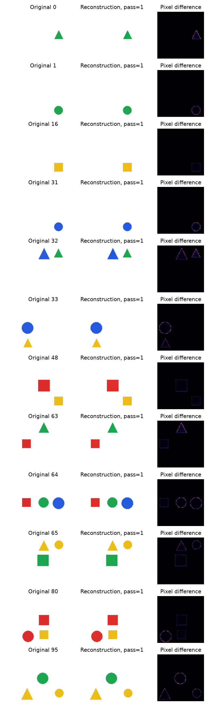
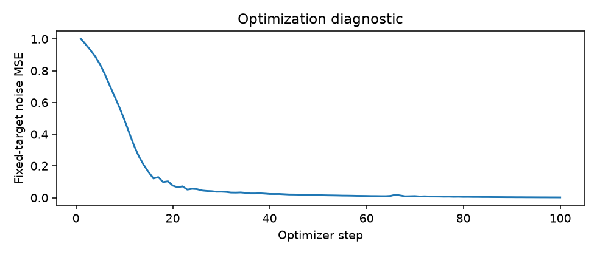

## **一、第三周交付与真实结果**

执行日期：2026-10-28。交付 [中文 Notebook](../../docs/learning/S2_第3周_图标数据与潜空间DiT基础.ipynb)、[数据卡](../../docs/data_cards/synthetic_icons_week3.md)、[L03 核心任务](../../learning/L03_DiT核心任务.md)。Notebook 有 101 个单元、22 个代码单元，已从干净内核顺序执行并保留输出；完整结构化记录为 [week3_results.json](week3_results.json)。

### **1. 结果与分母**

| 检查 | 实际结果 | 结论边界 |
| --- | --- | --- |
| 数据 | 14000 张，7318 场景组，14000 像素哈希唯一 | 场景组、组合与模板隔离通过；缩略图近似筛查有限 |
| 原图解析 | 14000 张全部属性正确 | 受控图标诊断，不代表 S3 生成解析可靠性 |
| VAE 重建 | 96/96 数量正确，192/192 颜色与形状正确，185/185 关系正确，96/96 全部属性正确 | 验证压力子集，不是测试集或无偏总体估计 |
| 像素 MSE | 0.001103816 | 在 [-1,1] 原始解码值上计算，不裁剪；属性评测图片裁剪量化为 RGB |
| 表示形状 | [96,4,16,16]，缩放 0.13025 | 固定后验均值，不假定潜变量已标准正态 |
| 缓存 | 256/256 训练样本；批量/单项最大差 0.0 | 重新加载精确一致，5 类身份变更拒绝；全量未做 |
| 主干规格 | 6 层、256 宽、4 头，7,372,560 参数 | 仅前向与输出形状检查，没有正式训练 |
| 教学拟合 | 2 层、128 宽、4 头，663,952 参数，100 步 | 固定 4 张、时间索引 499、固定噪声 |
| 固定监督 MSE | 1.00150967 → 0.00180716 | 优化链路可学习，不证明生成能力 |

颜色和形状以对象为分母；数量与全部成功以图像为分母；关系以请求关系为分母。数量不一致、不可解析的样本计入失败，没有从统计中丢弃。本次门槛首轮即通过，没有触发提高到 32 像素对象和 12 像素间距的复验。

### **2. 图像证据**



固定展示 12 个编号，覆盖 1–3 对象。Agent 视觉检查未见对象消失或关系翻转，主要误差在轮廓与边缘；不是人类理解验收。96 张逐图指标和标识保存在 JSON，未精选删除失败。



## **二、来源、配置与计算成本**

### **1. 数据和组件身份**

图标由 Pillow 本地生成，固定种子 20261028，配置 configs/datasets/icons_week3.yaml。真实数据与清单位于忽略目录；PNG 合计 6.91 MiB。清单 SHA-256：`4ab52fc580d9a5bf9b315a1c2449ab78a20cabcfb18a0d50631990b63b7371e4`。

冻结组件为 madebyollin/sdxl-vae-fp16-fix，revision `207b116dae70ace3637169f1ddd2434b91b3a8cd`，权重哈希在 configs/models/sdxl_vae.json。只下载配置及一份 Safetensors，没有下载整个 SDXL 或文本编码器。

新增 [DiT v2](../../docs/papers/DiT_Scalable_Diffusion_Models_with_Transformers_2212.09748v2.pdf)，四篇 PDF 全部核验哈希与可解析性。论文、作者与固定版本见 [论文清单](../../docs/papers/manifest.json)。教学结构依据 DiT 原论文及官方 models.py 独立实现；未复制官方模型源码或权重，未宣称复现 ImageNet 结果。

### **2. 实际设备与时间**

Python 3.12.14，PyTorch 2.14.1，最终 Notebook 使用 MPS FP32。受限进程没有检测到 MPS，因此先在 CPU 完成 96 张预检，耗时 64.06 秒；随后授权的本地 Notebook 内核检测到 MPS 并通过前向反向小案例，实际在 MPS 执行。

MPS 重建 6.29 秒；缓存 5.13 秒；100 步拟合 0.72 秒。Notebook 自加载模型到结果写入约 14.73 秒，加 CPU 预检 64.06 秒和前一次 Notebook 验证 38.96 秒，累计约 117.76 秒，未触及 30 分钟上限。安装、下载和数据质量检查另计。云费用 0 元，未调用收费资源。

## **三、数学检查、失败诊断与限制**

### **1. 实际通过的数学与工程检查**

- 缩放逆变换最大绝对差 9.54e-07，直接解码与适配器解码最大差 6.91e-06。
- 多通道手工 patch 顺序、逐索引、往返、非连续输入、非整除异常与梯度检查。
- 注意力与独立 Torch 算子及显式循环对照，调制逐 token 广播。
- 单 Block 初始严格恒等；完整模型初始输出为零，输出头→门控→注意力参数按预期获得梯度。
- 缓存文件重新加载一致；清单、模型 revision、缩放、预处理、编码模式变化均明确拒绝复用，额外测试覆盖 payload 篡改。

### **2. 应怎样解释失败与边界**

1. 删对象、改颜色、空白图三类人为已知错误均判失败，说明诊断器没有只用标准成功图测试；它仍不覆盖任意生成畸形。
2. 实测潜变量通道均值为 [2.236180305480957, 0.16181473433971405, 0.9333890080451965, -0.8128278851509094]，明显不是零；这不自动构成 bug，本周固定后验均值、窄图标分布和模型原缩放共同决定统计，不能临时重标准化后混用缓存。
3. VAE 在 128 像素几何图上通过，不证明更小对象、复杂插画、透明背景都能保留；本数据只生成白底 RGB。
4. 固定拟合损失下降不能代替新噪声、新时间、新图像与完整反向链的验证；本周没有生成样本。
5. Notebook 教学代码通过不等于你完成 L03，更不等于 L01/L02 前置已验收。

## **四、复现、验证与交接**

### **1. 实际执行入口**

```bash
uv sync --locked --extra notebook --extra latent
uv run --locked --extra notebook --extra latent python scripts/prepare_week3_assets.py
uv run --locked --extra notebook --extra latent python scripts/execute_learning.py docs/learning/S2_第3周_图标数据与潜空间DiT基础.ipynb --html-output artifacts/runs/s2_week3/learning_preview.html
uv run --locked --extra notebook --extra latent pytest
uv run --locked python scripts/check_dit_core.py
```

本次安装使用 uv sync --extra notebook --extra latent 更新锁文件，实际内核由 .venv/bin/python 运行，版本见上；锁文件重建与上述 locked 入口另行核验。资源脚本是显式下载入口，Notebook 使用本地权重、不会自动下载其他模型。项目主 CLI 的 train/sample/evaluate/cache 仍未实现。

### **2. 验收范围与任务状态**

Notebook 格式校验、22 个代码单元执行与部分数学结构检查通过。HTML 已导出，浏览器检查缩放、adaLN-Zero 公式以及数学错误节点与图片加载；另用本地图片工具检查 12 组重建、样本板和拟合曲线。没有冒称全页逐行视觉检查。

完整测试、Ruff 基线与保护哈希的最终结果见 [验证记录](week3_verification.json)。第一周 Notebook 和 week1QA 保留用户原始未提交改动，本周不重跑或修改。当前历史 Ruff/格式问题不在本轮修复，第三周不新增违规或放宽规则。

| 任务 | 状态 |
| --- | --- |
| S2-01 | 数据工程已验证；用户设计理解待复核 |
| S2-02 | 教学表示检查已验证；S1-06 个人依赖仍待做 |
| S2-03 | 256 张试点已验证，全量待做 |
| S2-04 | 教学数学与参考已验证；个人 src 核心待做 |
| S2-05 / S2-06 | 第四周待做 |

下一项个人动作：读第八至十章，合上答案完成 L03，运行 scripts/check_dit_core.py；当前输出“待做”、退出码 2。之后由 Agent 审查并连接训练器，同时补齐 L01/L02。实际代码、测试和文档只在本地提交，不推送远程。

提交前复核：第一周 Notebook 在本轮期间另有少量编辑，Agent 没有修改它；其当前内容保留并排除提交，其余 12 个受保护文件哈希一致。Ruff 历史问题数量仍为 13 项。
