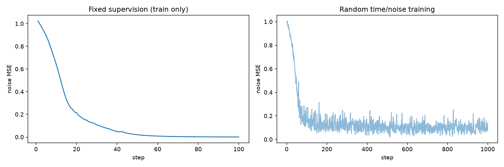
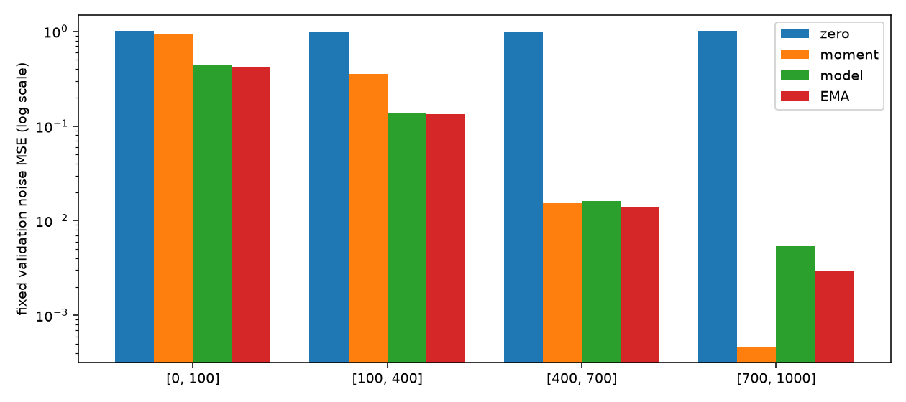
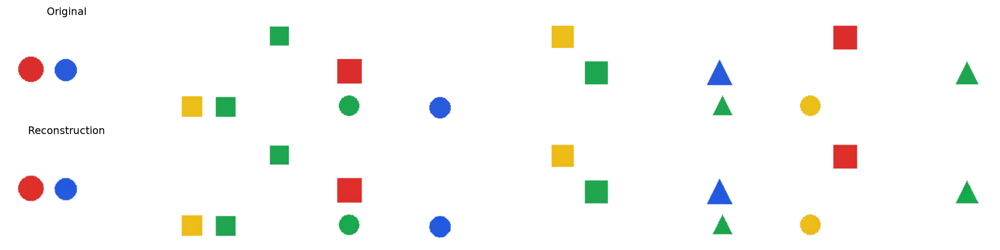
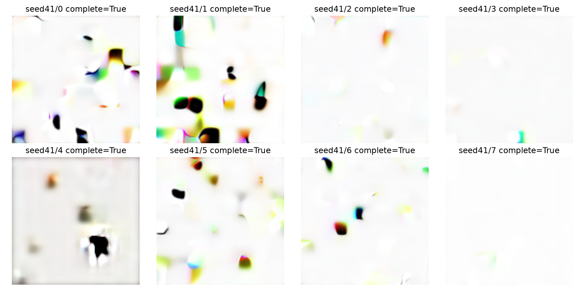
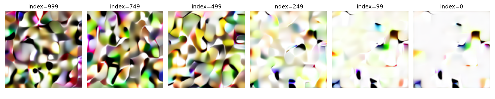
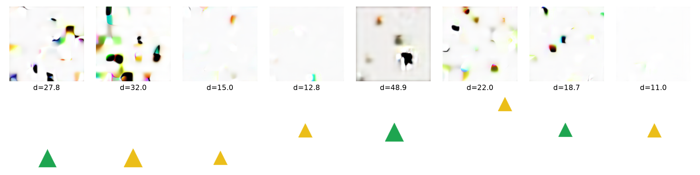

## **一、S2 第四周交付与真实结果**

执行日期：2026 年 10 月 30 日。入口：[潜空间扩散训练与采样 Notebook](../../docs/learning/S2_第4周_潜空间扩散训练与采样.ipynb)、[预登记配置](../../configs/experiments/s2_week4.yaml)、[个人接入任务](../../learning/L03_第四周训练连接任务.md)。本周实现并执行教学闭环，个人 VAE、DiT 核心与理解仍待验收。DDPM 明确使用用户已完成的 src 实现。

### **1. 结果与完成边界**

| 项目 | 实测 | 结论 |
| --- | --- | --- |
| 完整缓存 | train 10000、validation 1000；4×16×16 FP32，42.96875 MiB | 仅训练/验证，未编码或使用测试集 |
| 教学模型 | 2层、128宽、4头，663952参数 | notebook_reference，源码哈希固定 |
| 主规格 | 6层、256宽、4头，7372560参数 | 仅前向与形状，不称正式训练基线 |
| 固定监督 | 100步；MSE 1.02348983 → 0.00059556 | 固定4张、时间99/399/699/999、固定噪声；可拟合不等于可生成 |
| 随机时间/噪声 | 500步后新建模型恢复到1000步 | StatefulBatchStream；个人DDPM+显式教学DiT |
| 反向链 | 1000步、1000次模型求值，8张 | 完整DDPM，无跳步，无CFG |
| 规则诊断 | 解析失败6/8；对象数[0, 1, 0, 0, 0, 1, 0, 0] | 有限规则解析器，不是正式S3质量指标 |

工程闭环已运行，**生成质量未达标**。原始全样本显示空白、碎块、黑边和形状融合，不能标为可靠图标生成系统。没有筛掉失败、换种子选图或用预训练生成主干替代。M08、个人S2-04和整个阶段二不勾选。

### **2. 验证集按时间分桶的噪声 MSE**

每桶16张固定验证图，时间/噪声种子20261031。高斯矩基线只用训练缓存的逐通道均值与方差；它不是实际数据的最优预测器。

| 代码时间范围（左闭右开） | 零预测 | 高斯矩基线 | 训练后参数 | EMA |
| --- | --- | --- | --- | --- |
| [0, 100] | 1.012591 | 0.926835 | 0.435724 | 0.415645 |
| [100, 400] | 1.002108 | 0.352476 | 0.138388 | 0.134263 |
| [400, 700] | 0.990130 | 0.015402 | 0.016093 | 0.013844 |
| [700, 1000] | 1.004388 | 0.000463 | 0.005458 | 0.002903 |

模型在低/中噪声桶优于这项简单基线，但最高噪声桶仍较差。不能只把总 MSE 低于1解释成理解了形状。高噪声预测误差经过干净值反推会被放大，末端又远离数据支持；它提供排查方向，不足以证明全部失败来自单一模块。





## **二、重建、生成与失败证据**

### **1. 重建是表示对照，生成没有逐图真值**









主 Agent 实际查看以上重建、生成和最近邻图。原图/重建中基本对象仍保留，采样图存在明显结构退化；因此不能只把生成错误归因于冻结 VAE。解析器只对本项目调色板/连通区域有效，6/8失败之外的两张也不代表视觉质量合格。

三类实际失败：空白/几乎无对象，破碎色块与混合边缘，形状融合/数量不可控。它们可能共同涉及训练不足、末端噪声偏差和采样误差累计；本次未做因果消融，不预先指定唯一原因。下一项实验是保持数据、缩放、主干、种子和采样器，独立登记延长训练，再对照同一验证探针及全部固定样本。

潜变量最近邻是欧氏距离筛查，受尺度、背景和编码方式影响；不作为排除记忆、感知相似度或条件遵循的证明。本模型没有输入描述，所以条件准确率记为不适用，不将随机图与任意描述配对评分。

## **三、身份、训练可靠性与成本**

### **1. 可追溯输入与恢复**

图标版本 synthetic_icons_week3_v1；清单 SHA-256：`4ab52fc580d9a5bf9b315a1c2449ab78a20cabcfb18a0d50631990b63b7371e4`。VAE 为 madebyollin/sdxl-vae-fp16-fix，revision `207b116dae70ace3637169f1ddd2434b91b3a8cd`，缩放0.13025，固定后验均值，不另做通道标准化。模型参考单元源码 SHA-256：`1add9941d358c3d50aef18cb6cc0f3b9dd37568befcea0499d8bc308b79a8669`。

新增 data.latent 建立分片、原子索引、身份与载荷验证；不完整缓存拒绝作为完整数据集。新增 training.latent 显式接收外部模型和个人DDPM，冻结数据/张量、模型来源和实际代码/结构、完整日程、裁剪、监督与probe、数据顺序、Torch版本；无参考fallback。正常扩展步数或更换输出目录允许恢复。

新增18项CPU工程测试覆盖中断续建、输入哈希、分片篡改、身份变更、连续与恢复逐位一致、Torch RNG与下一批位置，以及两个独立解释器进程的真实恢复。Notebook在MPS实际从500步恢复到1000步；CPU的逐位保证不推广到跨设备。

首次执行导入的训练工程尚未包含最终的完整日程方法身份，复验时保护正确拒绝旧目录。旧结果保留在忽略目录，最终版改用 `artifacts/runs/s2_week4/verified_v2`，没有关闭或绕过检查。普通 train_denoiser 的旧恢复局限仍存在，新增保证只属于明确的包装入口。

### **2. 实际设备与耗时**

环境：Python 3.12.14、PyTorch 2.14.1，macOS arm64，实际设备mps、FP32、单训练种子20261030。受限进程内MPS不可见，实际Notebook内核先通过MPS前向/反向小案例后使用MPS。无云GPU、模型API或其他收费资源，费用0元。

首次完整缓存编码及加载为225.27秒（训练分片202.73秒、验证分片21.16秒，另计模型加载/索引）；最终版执行复用并核验缓存，整轮20.22秒。最终采样链3.66秒，解码与诊断1.94秒；固定拟合1.03秒。三个成功执行累计283.07秒，低于30分钟；失败的加载/身份预检、环境安装、测试、下载与渲染另计，不冒充完整GPU成本审计。重复执行是同种子的技术验收，不作为独立训练重复。

## **四、论文、验证与交接**

### **1. 阅读安排与复现**

核验并复用DDPM、VAE、LDM、DiT四篇，补充固定DDIM `2010.02502v4`：22页、10,857,218bytes、SHA-256 `07cb8796d7c100bf7c02bc575f16aab72c32630a8f85abd54ad45dc4f63e80fb`。LDM/DiT本周主读，DDIM只解释子序列采样，不实现。导航见 [论文目录](../../docs/papers/README.md)，核验见 [week4_papers.json](week4_papers.json)。

```bash
uv sync --locked --extra notebook --extra latent
uv run --locked --extra notebook --extra latent python scripts/execute_learning.py docs/learning/S2_第4周_潜空间扩散训练与采样.ipynb --html-output artifacts/runs/s2_week4/learning_preview.html
uv run --locked --extra notebook --extra latent pytest
uv run --locked python scripts/check_dit_core.py
```

个人DiT验收仍返回待做/2；个人VAE同样待做，不用Notebook答案代替。完整验证与旧文件保护结果见 [week4_verification.json](week4_verification.json)。Notebook共有72个单元、15个代码单元，最终版从干净内核顺序执行，无未处理异常，保留真实输出。HTML已导出，公式、图片与表格做部分浏览器抽查，不声称逐页逐行验收。

### **2. 检查结果与第二周在做的作业**

本周新增18项工程测试通过，三个新Python文件和新Notebook的Ruff、格式与接口结构检查通过；笔记与导航结构检查通过。任务开始时完整测试72项通过；最终完整测试88项通过、2项失败，均为旧测试仍要求VAE个人重参数化抛出待实现异常，而用户在本轮期间已添加实现。未替用户修改作业、旧断言或提前做VAE验收。

Python全仓检查当前还有用户正在编辑的vae_core.py缺少Results与导入排序，以及tiny_vae.py格式问题；全局Ruff另有第一/二周Notebook的6项问题。本周未放宽检查规则，也不把本周独立通过写成全仓通过。学习文件保护基线中，两项第二周文件发生外部编辑，其余文件哈希保持一致；新检测到的两份个人VAE源码改动同样保留。

### **3. 提交建议与下一步**

本轮不执行git add、commit或push，Agent没有修改旧Notebook、第二周图片、week1QA或docs/papers/ddpm。你在此期间继续修改的第二周Notebook、二维潜空间图片与个人VAE代码均保留。实际数据、缓存和权重留在忽略目录。下一步由你完成第二周VAE作业、个人DiT和脱稿理解验收；生成质量与主规格训练继续独立推进。

建议提交名：`feat(s2): 添加第四周潜空间扩散训练与采样实验`。交接见 [任务记录](../tasks/week4.md)。
