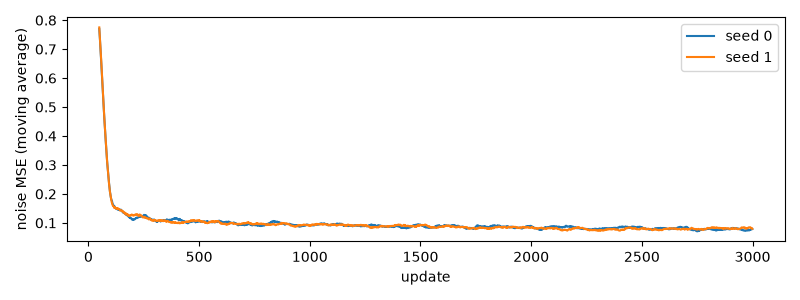
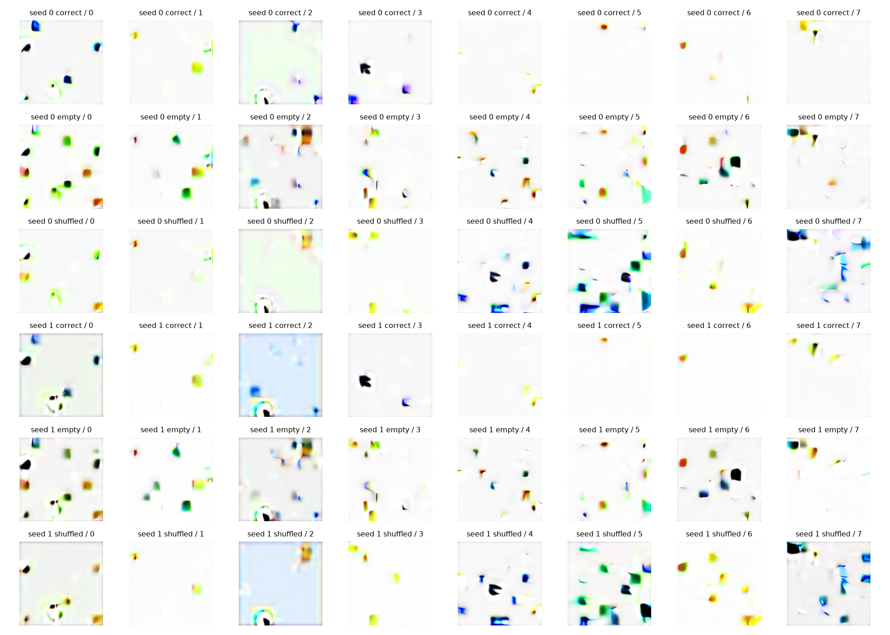
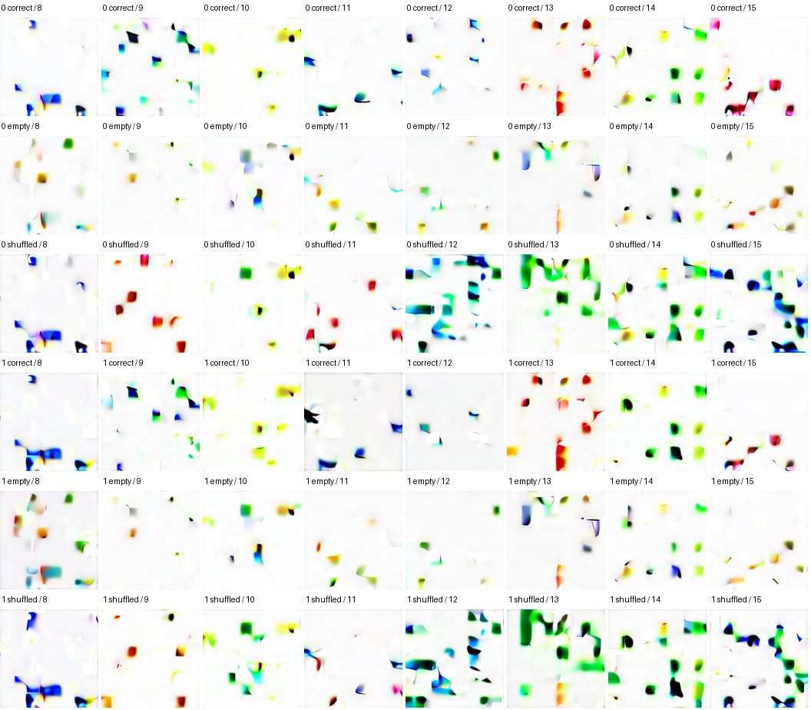
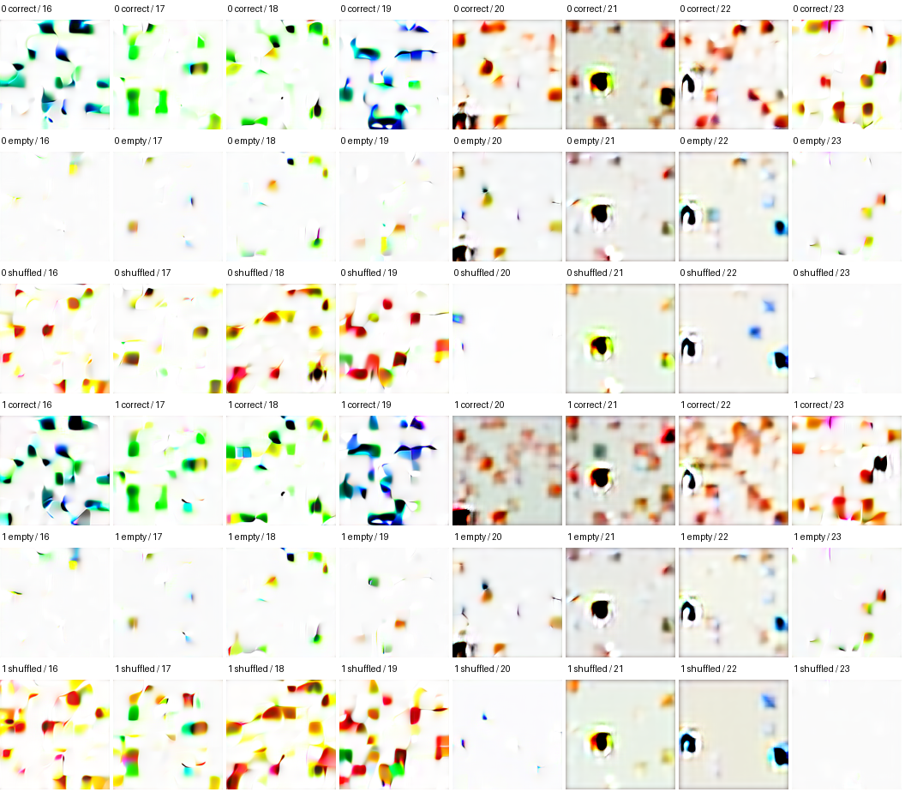
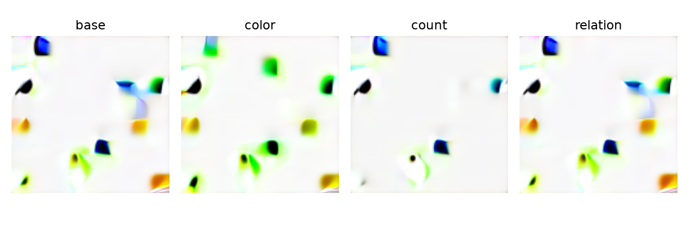
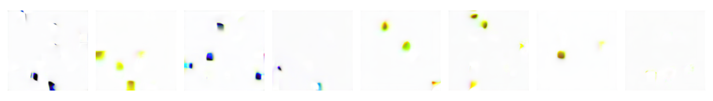
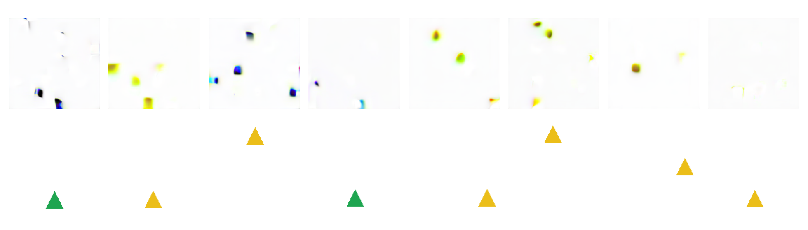
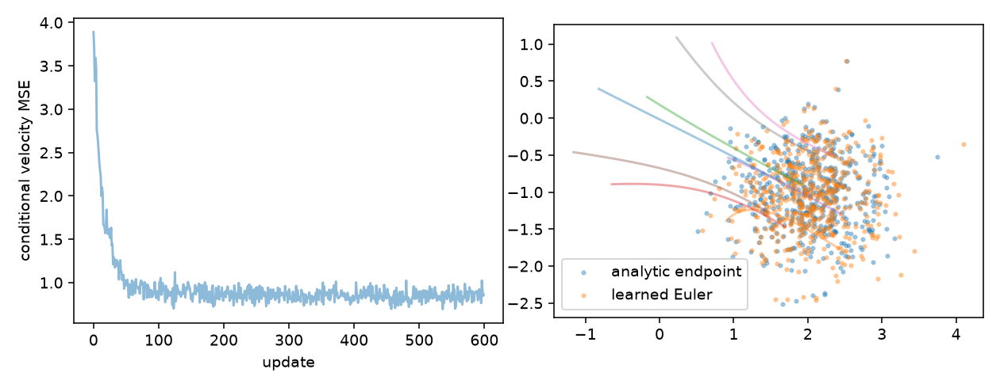

## **一、验收结论**

2026 年 11 月 5 日，S3 教学链路与工程已实际运行：冻结 CLIP、完整文本缓存、两训练种子、三条件对照、单属性干预、DDIM/完整 DDPM、二维 Flow 与研究预登记均有证据。**S3 第一里程碑未通过：生成仍不可用，个人 DiT/CFG/Flow 与理解未验收，人工评测审核未完成。**

正确条件在两个种子上分别为 2/24、1/24 综合成功，空与打乱条件均为 0/24，但配对 bootstrap 95% 区间分别为 [0,20.83%]、[0,12.50%]，包含零。它们是已参与 CFG 选型的验证请求，存在选型偏差，不是最终泛化证据。全部单属性干预的综合指标失败，不声称控制能力达标。

入口：[教学 Notebook](../../docs/learning/S3_文本条件CFG与可信评测.ipynb)、[结构化结果](results.json)、[固定验证请求](validation_prompts.json)、[任务状态](../tasks/stage3.md)、[L04](../../learning/L04_文本条件与CFG核心任务.md)。

## **二、配置、来源与资源**

| 项目 | 真实设置 |
| --- | --- |
| 最终 run_id | s3_conditional_v3 |
| 执行环境 | Python 3.12.14、Torch 2.14.1，MPS FP32；设备小前反向通过 |
| 数据 | 固定训练 10000、验证 1000；测试未编码或进行性能评估 |
| 冻结 VAE | SDXL VAE 固定组件，后验均值 × 配置缩放 0.13025 |
| 冻结文本 | openai/clip-vit-base-patch32，revision 3d74acf9a28c67741b2f4f2ea7635f0aaf6f0268 |
| 文本缓存 | 4115 条去重描述（含空文本），[4115,154,512] FP16，649553260 字节 |
| 上下文 | 每段最多 75 内容 token，BOS/EOS 后 77；最多两段，无静默截断 |
| 描述长度 | train+validation 中 273 行超单段容量，去重后 270 条；最长 76 内容 token |
| 量化探针 | FP32→FP16→FP32 最大绝对误差 0.00780869；不是全库误差上界 |
| 空条件 | 同一编码器的空字符串，2 个有效 token，缺失段全 mask |
| 教学模型 | 2 层/128/4 头，993170 参数 |
| 主规格 | 6 层/256/4 头，9741078 参数，仅前向，未训练 |
| DDPM | 用户已验收的 src；T=1000，线性 beta=0.0001→0.02，潜变量不做像素裁剪 |
| 优化 | AdamW lr=0.0002、无 weight decay、batch 32（保留短尾批）、梯度裁剪 1、EMA=0.99 |
| 条件丢弃 | 每样本 p=0.1，token/mask 同时替换；10000 次测试频率 0.1007 |
| 来源 | DiT、Cross-Attention、CFG、二维 Flow 显式 notebook_reference；不替换个人接口 |

CLIP 上游约 605 MB 组合权重先按官方 LFS SHA-256 核验，再严格提取文本。当前 Transformers 5 的独立模型不含旧 text_model 前缀；转换一一重命名，并验证旧 position_ids 等于固定 arange 后移除该确定性 buffer。未用 strict=False 忽略参数。最终只保留约 253 MB 文本 Safetensors 与 tokenizer，固定身份见 configs/models/clip_text.json。

分段保留完整 token，但每段局部上下文独立，不称原版 CLIP 支持 154 长联合上下文。token 特征、mask、文本顺序、空条件、量化与数据 ID 进入身份。Tqdm 缺 ipywidgets、测试 80-token 输入时 tokenizer 的原始长度警告均有保留；实际送入每个网络窗口不超 77，执行没有未处理异常。

## **三、训练、数值与恢复**

| 种子 | 实际更新数 | 训练及最终保存耗时/秒 | 停止原因 |
| --- | --- | --- | --- |
| 0 | 3000 | 185.46 | max_steps |
| 1 | 3000 | 181.34 | max_steps |

缓存配对、padding 不变性、零输出初始化及 5 步后文本投影梯度均通过。手算 softmax 权重 [0.25,0.75,0] 对照成立。固定带噪图像、时间和噪声的验证探针显示模型数值上使用条件；例如 t=250 的噪声 MSE，seed0 正确/打乱约 0.10972/0.12825，seed1 约 0.10823/0.12781。它们不能替代真实生成成功率。

恢复测试使用小型 CPU 条件网络，连续 4 步与 2→4 步恢复逐项比较模型、EMA、Adam 状态、Python/NumPy/Torch RNG 和数据排列/游标，均一致；条件丢弃改变被拒绝。这里没有声称真实 MPS 的这两轮训练执行过中断恢复，也不把新条件包装器保证推广给旧 train_denoiser。



## **四、条件结果与失败分析**

验证固定 24 条，1/2/3 对象各 8，16 条包含关系，共 49 条关系。只用 seed0 从 CFG=1/3/5 选择，以综合成功最高、平局取更小的 CFG，本轮选择 3。两个种子和三种条件使用相同初始噪声；打乱是一一置换且每条语义不同，指标比较仍以原请求为目标。

| 种子 | 条件 | 数量 | 颜色多重集 | 形状多重集 | 绑定 | 综合 | 解析失败 |
| --- | --- | --- | --- | --- | --- | --- | --- |
| 0 | correct | 33.3% | 29.2% | 8.3% | 8.3% | 8.3% | 50.0% |
| 0 | empty | 25.0% | 8.3% | 4.2% | 0.0% | 0.0% | 37.5% |
| 0 | shuffled | 12.5% | 0.0% | 4.2% | 0.0% | 0.0% | 54.2% |
| 1 | correct | 8.3% | 4.2% | 4.2% | 4.2% | 4.2% | 70.8% |
| 1 | empty | 29.2% | 8.3% | 12.5% | 0.0% | 0.0% | 33.3% |
| 1 | shuffled | 20.8% | 0.0% | 4.2% | 0.0% | 0.0% | 58.3% |

关系整图成功率各组均为 0/16。规则失败的定义是未得到 1–3 个可解析色板对象，不覆盖一切人类可见缺陷；少量“成功”需要独立人工确认。第三周重建评分器按原图中心对齐，本轮新评分只用请求的多重集、绑定和有向关系，不使用未提示的绝对位置。

全量 144 张对照图保存在本地 review；Notebook 包含全部 24 条请求的图组，不按成功筛选：







实际失败至少有三类：**对象碎片和缺失**，画面近乎空白或边缘小块；**形状与绑定失败**，颜色斑块不能稳定构成圆方三角及对应关系；**数量与空间关系失败**，多对象请求不能可靠完成。Agent 对上述全量图组和完整 DDPM、干预图作视觉抽查，观察与“当前不可用”的结论一致；不是 100+100 人工独立标签。

同噪声的基准/改色/改数量/反关系干预全部综合失败。改色已限定训练出现的颜色形状组合（蓝三角→绿三角），避免混入组合外“红三角”。数量干预获得了一个蓝色对象，但形状不对，不算综合成功。



下一项最小诊断：在现有验证集、固定预算下分开检查单对象形状与背景稳定性；再比较低噪声桶与高噪声桶、引导强度和模型容量。仅有数值条件信号不足以证明语义控制；还没有足够消融把失败归因于某一个模块。原 VAE 重建通过也不等于生成主干已学好。

## **五、评测可靠性与封存测试**

100 张原始渲染图全部属性正确；50 张空白全部判失败，50 张轻度模糊仍全部正确。这是确定变换控制，不叫人工审核。已输出 344 条匿名盲审记录（100 原图、100 退化、144 生成），human=null，reviewer=null。人工表位于 review/blind/human_review.jsonl，图像匿名并随机排序，不展示条件组、种子或解析答案；机器映射保存在 review/review_key.json，审核后由 Agent 按图像和请求身份校验再合并。机器分析清单 blind_review.jsonl 不作为独立人工填写入口。重复准备保护已填标签。

正式审核需要至少 100 原图与 100 生成/退化图，逐属性 0/1 人工标签、一致性至少 95%，关系请求单独核对；不能用重复 ID 凑数量。门槛脚本拒绝空标签、重复 ID 和低一致性，无绕过选项。标准几何图的高分不足以证明解析器对生成碎片可靠，生成指标目前保持探索性。

测试集 test_id/test_combo/test_template 没有编码、选型或性能评价。当前个人 DiT/条件/CFG、人工可靠性仍待做，且验证收益与干预不足以完成里程碑。后续入口：

```bash
uv run --locked --extra notebook --extra latent --extra conditioning python scripts/evaluate_stage3_holdout.py --run-dir artifacts/runs/s3_conditional_v3 --review artifacts/runs/s3_conditional_v3/review/blind/human_review.jsonl --notebook-reference
```

当前应返回待做/退出码 2；不读取测试进行生成。即使未来通过门槛并运行，权重来源仍明确为 notebook_reference。当前没有伪造三个测试集合的结果。

## **六、采样、真实 NFE 与效率**

DDIM eta=0 按正确跨步公式更新，最后干净端点累计系数为 1；另实际完成 8 张完整 1000 步 DDPM。解析 oracle 测试确认两种采样到已知 clean，超时样本明确不完整，模型异常时恢复训练模式。

| DDIM 更新数 | CFG | 每图等价 NFE | batch8 去噪中位耗时/秒 |
| --- | --- | --- | --- |
| 10 | 1 | 10 | 0.0634 |
| 10 | 3 | 20 | 0.0887 |
| 20 | 1 | 20 | 0.1288 |
| 20 | 3 | 40 | 0.2474 |
| 40 | 1 | 40 | 0.2995 |
| 40 | 3 | 80 | 0.4782 |

每项先预热、同步 MPS，重复 3 次，完整重复数据在 results.json。两个分支合批是一次 Python 调用，但等价 NFE 为两倍，不能隐去额外计算。40 步 CFG=3 的 80 NFE 也不是 S4 主比较中的 40 NFE，预登记已区分按 NFE 与按更新数的表。

完整 DDPM：1000 次模型调用、每图 2000 NFE、8 图总 16000 分支样本，去噪 15.468 秒。在线文本编码+40 步 CFG=3 去噪+VAE 解码约 1.514 秒，batch=8，模型已加载、没有文件 I/O。在线使用 FP32 文本，缓存为 FP16，不声称逐位相同或用两者差值精确分摊解码成本。MPS 峰值显存没有与 CUDA 同口径统计，保持 null。





最近邻是训练潜变量 L2 诊断，不能当作感知距离、隐私证明或正式记忆率。全部输出存在明显质量缺陷，不将更快的求值单独写成质量提升。

## **七、Flow、论文与下一阶段**

二维独立端点线性路径采用噪声0→数据1，回归端点差，网络最优解为给定当前位置的条件期望速度。常速度方向/终点通过；高斯解析场 Euler 的 10/20/40 步 RMSE 为 0.068277、0.035267、0.017942，符合步长缩小误差下降。小型 MLP 实际训练 600 步，采样终点均值约 (2.030,-1.044)，方差约 (0.241,0.244)，目标 (2,-1)、(0.25,0.25)。仅二维高斯，不是图像 Flow 或全局 OT。



新增 CFG、CLIP、Flow Matching 与 REPA/RAE/MeanFlow 六篇论文；第一周等已有五篇哈希复核通过，均保留固定版本。PDF 身份/所有页解析、页数、大小、SHA-256 已核验，六篇首页作视觉抽查，未声称逐页视觉审阅。对应 [阅读导航](../../docs/papers/README.md)、[研究卡](../research/s3_research_cards.md)、[Sana 预研](../research/s3_sana_feasibility.md)、[S4 预登记](../../configs/experiments/s4_preregistered.yaml)。没有启动图像 Flow、完整 Sana 或 LoRA。

## **八、复现、检查与保护范围**

```bash
uv sync --locked --extra notebook --extra latent --extra conditioning
uv run --locked --extra notebook --extra latent --extra conditioning python scripts/prepare_stage3_assets.py
uv run --locked --extra notebook --extra latent --extra conditioning python scripts/execute_learning.py docs/learning/S3_文本条件CFG与可信评测.ipynb --html-output artifacts/runs/s3_conditional_v3/learning_preview.html
uv run --locked python scripts/check_code_annotations.py
uv run --locked --extra notebook --extra latent --extra conditioning pytest
uv run --locked minigen doctor --device cpu --json
```

最终 Notebook 74 单元，其中 19 代码单元从干净内核顺序执行 1–19，无错误输出。执行后仅修正 Markdown 数学转义并补充全部验证图组的 Markdown 附件，所有代码/输出保留，代码源 SHA-256 为 4261a441eeb8e389ea277bb5b5e0d7c3e7fbf8c6a860b2dc4a2b54ed142e23e9。HTML 浏览器核验 99 个 MathJax 节点、0 错误、8/8 内嵌图可读，抽查总览、CFG 和 Flow 公式；不是全页逐像素审查。

完整 pytest 104 项通过；57 Python 文件的类型/形状/接口结构检查无问题。新增和本轮修改代码的 Ruff 与格式检查通过；全局 Python 检查仍有用户未提交 TinyVAE 的原有 E501/格式问题，旧 Notebook 的全局问题保留，不修改规则掩盖。两条旧 VAE 待实现断言已改为已验收核心的独立高斯/梯度检查；VAE 源码只修注释、导入与格式，执行 AST 与 HEAD 相同，没有改数学主体。

v1 完整计算 490.79 秒，审查发现颜色干预混入组合外变化，证据保留；v2 在修正过程中因漏导入而主动中止，已训练 296 步/20.34 秒，日志保留且没有当作完整训练；v3 最终完整计算 443.20 秒。两完整轮累计约 934 秒，另计中止训练与短准备/CPU复核，仍在本轮 30 分钟本地计算约束内。原始下载/环境准备另计，云费用 0 元。重复技术执行采用相同两种种子，不当成四次独立训练。

用户原有第二/三周笔记、TinyVAE、问答目录移动与旧文件删除的基线保持不变，不纳入提交。真实数据、token/潜变量缓存、模型权重与原始逐图输出仍在忽略目录；仅提交必要图表、配置、代码、文档与小型结果。PDF 在 .gitattributes 中标为二进制，保持原始字节并避免文本差异/换行处理。没有 push。
