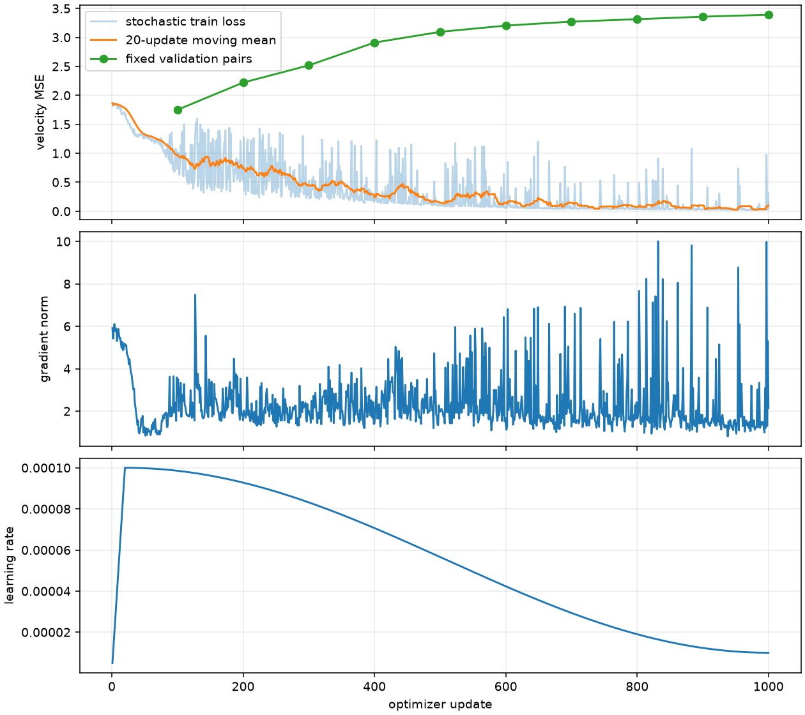
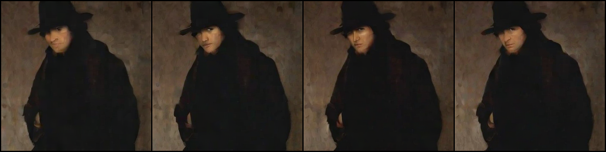
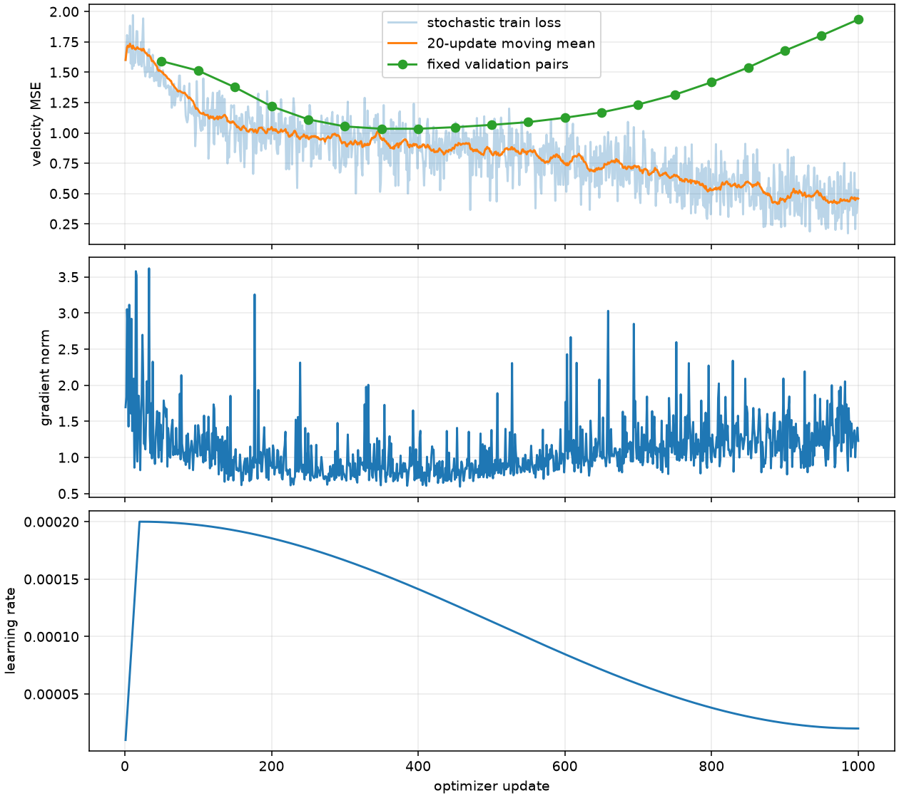
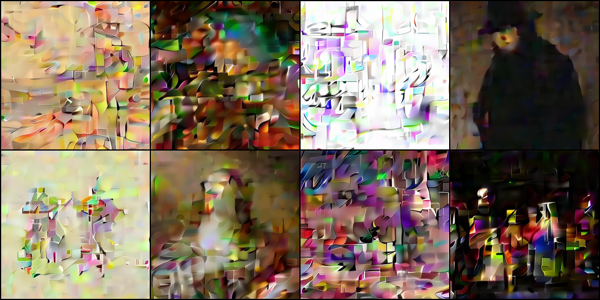

## **一、收尾结论**

2026-11-10，在 `db719ca` 的 B0 上完成单样本过拟合、原固定 16 图的单变量学习率对照，以及训练/采样/冻结 VAE 链路审查。**单样本能生成清晰可辨的人物；16 图有限训练仍未通过可辨生成门槛。** P3 的工程可用性证据增强，P3-05 的质量项保持未通过，P3-06 CUDA 保持待执行。

本轮没有确认 Flow 方向、速度目标、Latent 缩放或 EMA/Checkpoint 载入的数值错误，因此没有为改善图像而替换算法、模型或数据。后续 P4 只推进用户已授权的本地主体工程；正式三模型质量和云端实验分别待验。

## **二、诊断顺序与证据**

### **1. 先复核既有链路**

独立只读复核使用旧 1000 步 EMA、两个固定训练样本和 CPU FP32，保留 [原始数值回执](p4/old_checkpoint_diagnostic.json)。

| 检查 | 实测与解释 |
| --- | --- |
| Flow 路径与目标 | $z_t=(1-t)\epsilon+tz$，目标 $z-\epsilon$；采样从 0 正向积分到 1 |
| 初噪端预测 | t=0 速度 MSE=0.29734，对负初噪的投影系数 1.01833；已经学到去除初噪，不能写成方向接反 |
| 已知目标 Oracle | Euler40 / Heun20 终点最大绝对差 2.62e-6 / 1.31e-6；仅验证积分，不代表生成能力 |
| 实际 Euler40 / Heun20 | 到选定目标的 latent MSE=0.48467 / 0.49963；增加积分阶数未显示改善，非正式质量指标 |
| VAE | 固定 SDXL，mode 缓存，scale=0.13025；编码乘、解码除，RGB 与 [-1,1] 规则保持 P2 |
| 条件与 CFG | 缓存 mask、真实空条件，$v_u+s(v_c-v_u)$；s=1 跳过空分支 |
| EMA 与载入 | strict 载入；EMA/online 参数 RMS 差约 1.26e-4，未见载入错权重证据 |

接近 t=1 时，目标中包含无法从干净图确定的独立噪声，端点速度 MSE 不趋近零并不直接表明实现错误。额外记录 $\hat z=z_t+(1-t)\hat v$ 的端点估计误差，避免把不同时间的原始速度损失直接解释为图像质量。

### **2. 单样本：保持原训练配方**

选择原 16 图子集的第 4 张（train index 24453，`ab-30577`）。保持 B0 30,359,824 参数、256×256、冻结缓存、随机时间和噪声、学习率 1e-4、20 步 warmup/1000 步余弦、条件丢弃 0.1、EMA 0.99；数据流每步实际 **1 个样本**，不是把 batch=4 写成四个独立噪声。1000 步、600 秒上限，MPS FP32 实际循环 **102.545 秒**。





四个初噪来自 seed=90210，EMA Euler40 均能辨认帽子、脸和衣服，布局接近缓存参考。在线权重也得到可辨结果，说明生成链路有拟合单图的能力；这是记忆/过拟合诊断，不是泛化或用户人工质量验收。

| 单样本采样 | 相对目标 latent MSE | 解码参考 MSE | 主干求值 |
| --- | ---: | ---: | ---: |
| online Euler40 | 0.005135 | 0.000231 | 40 |
| EMA Euler40 | 0.005133 | 0.000221 | 40 |
| EMA Heun20 | 0.005935 | 0.000239 | 40 |
| EMA Euler200 | 0.005396 | 0.000228 | 200 |
| EMA Euler40、CFG3 | 0.006196 | 0.000283 | 80 |

无需增加到 200 NFE 或提高 CFG 即可生成单图，未见采样配置是原失败主因的证据。[单样本完整诊断](p4/single_diagnosis.json) · [运行身份](p4/single_run.json) · [逐步损失](p4/single_metrics.jsonl)。

### **3. 回到原 16 图：学习率对照**

保留原 16 张、模型初始化 seed=0、batch=4、随机时间和噪声、步数/日程与条件丢弃；影响优化轨迹的配方仅将峰值 LR 从 1e-4 改为 Plan 允许诊断的 2e-4。1000 步、600 秒上限，MPS FP32 实际循环 **146.724 秒**。运行限时另从 1800 秒改为 600 秒，周期保存从每 100 步改为每 500 步，并取消旧的额外 0/100 步快照；两组都完成 1000 步、没有触及限时，保存设置不改变梯度更新。这是训练拟合假设的对照，**未据此选择正式三模型学习率**；正式选型仍需要独立验证协议。

首 20 步均值 1.691121，末 20 步均值 0.458359，低于旧 1e-4 配方末段的 0.751895。但图像仍有重复色块、异常高频纹理，主体与细节没有可靠恢复。





上图与 P3 原结果保持同一 8 条提示、seed=20261110、EMA、CFG1、Euler40。另用 seed=90210 的前 4 张做在线/EMA、Heun20/Euler40、Euler200 和 CFG3 诊断；原始全套图和缓存解码参考保留在 `artifacts/runs/p3_close_sixteen_diagnosis/`。没有挑选成功图替换整组结果。

这四张诊断的 EMA Euler40 到选定目标 latent MSE=0.179570，Heun20=0.185642、Euler200=0.186777、CFG3=0.333784；更高积分预算或 guidance 没有解决结构失败。该误差只帮助定位训练样本拟合，不是多模态生成质量评测。[完整诊断](p4/sixteen_diagnosis.json) · [运行身份](p4/sixteen_run.json) · [逐步损失](p4/sixteen_metrics.jsonl)。

## **三、原因判断、修复与未验证假设**

- **已验证**：当前数学/实现链路可以从随机初噪还原一个已训练样本。缓存、解码、时间方向、EMA 和在线载入之间没有发现可确认的不一致。
- **证据支持但尚非唯一归因**：16 图的结构拟合不足、训练分布与积分轨迹的误差累积、样本复杂度及条件记忆共同限制短训。学习率对照降低误差，却未恢复可辨内容。
- **没有证据支持**：通过换 VAE、重建缓存、换长方形分辨率、提高 CFG 或堆叠积分步即可修复。均未擅自改动。
- **后续可证伪项**：对分时间/频率的端点预测误差做分析；在固定预算下逐级增加不同样本的数量，检查结构何时退化；进一步验证条件绑定与优化日程。未经新范围确认，不继续扩张本轮训练。
- **工程补强**：P4 中补显式 Flow 目标身份、三架构工厂、失败记录及统一产物元数据。这些是接口可靠性改进，不能被说成“修复了导致 P3 图像失败的已知 bug”。

本轮两次诊断训练共 **249.269 秒** 循环时间，采样另记；无收费 GPU/API，无正式长训。单图成功没有降低原 16–32 图的质量标准。P3-05 仍不勾选，P3-06 真实 CUDA/AMP/吞吐仍待云端。

## **四、复现与保存**

```bash
# 从仓库根执行；已存在目录不会覆盖，复做需复制配置设置新输出目录
uv run --locked --offline --no-sync minigen train --config configs/training/p3_close_single.json --device mps
uv run --locked --offline --no-sync python scripts/diagnose_flow_quality.py --config configs/training/p3_close_single.json --checkpoint artifacts/runs/p3_close_single/last.pt --output artifacts/runs/single_review_new --device mps
uv run --locked --offline --no-sync minigen train --config configs/training/p3_close_sixteen.json --device mps
uv run --locked --offline --no-sync python scripts/diagnose_flow_quality.py --config configs/training/p3_close_sixteen.json --checkpoint artifacts/runs/p3_close_sixteen/last.pt --output artifacts/runs/sixteen_review_new --device mps
```

以上诊断在 P4 源码变更前运行，检查点保持其旧 v1 身份；P4 新读取器兼容明确的历史 Flow 格式采样，不篡改旧文件。严格训练恢复仍要求相同源码摘要，不能把这批旧训练的数值轨迹冒充新工程版本。旧 P0–P3 报告和 Notebook 保留；本报告是新增证据。
