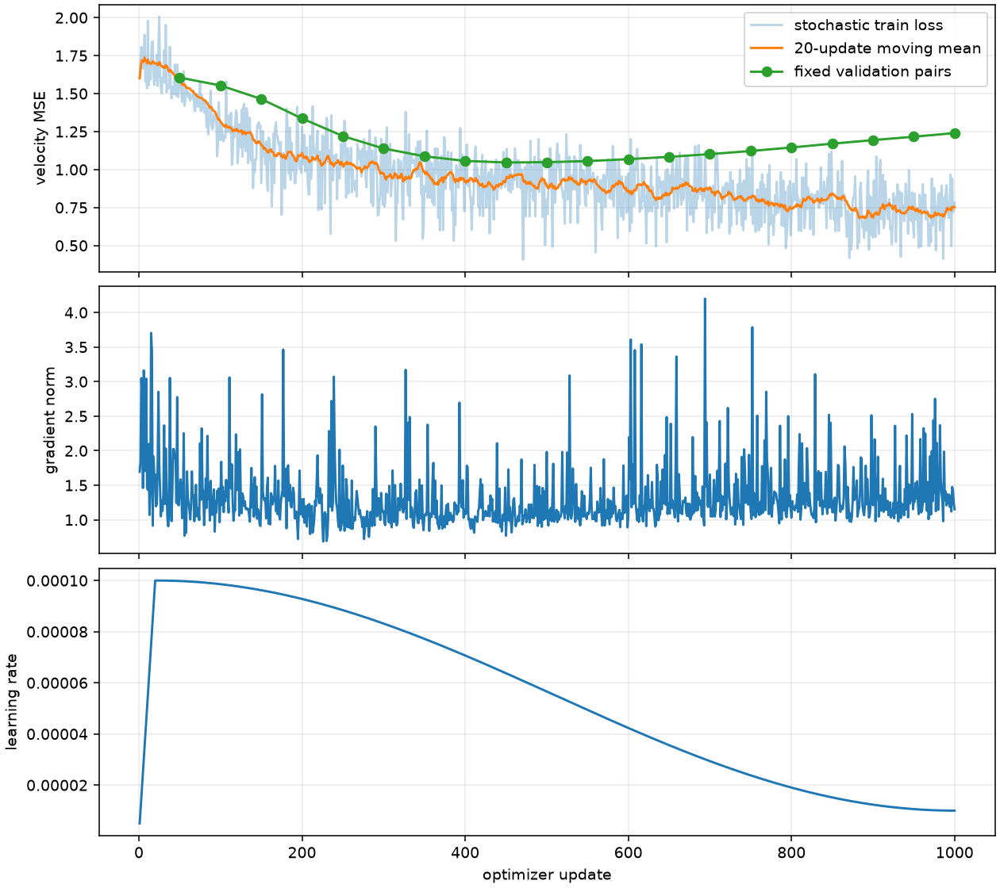
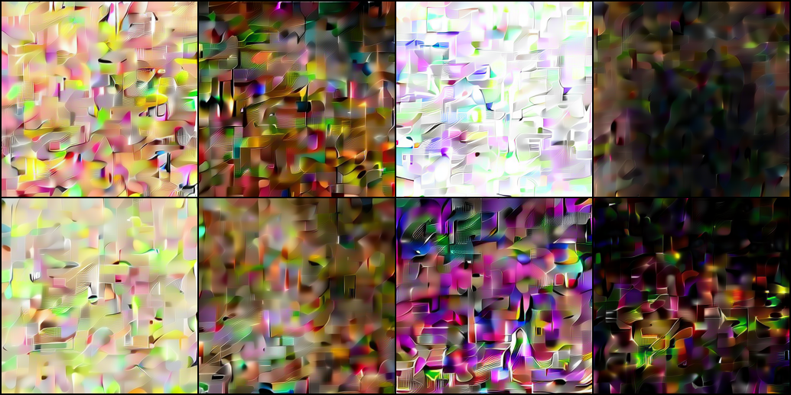
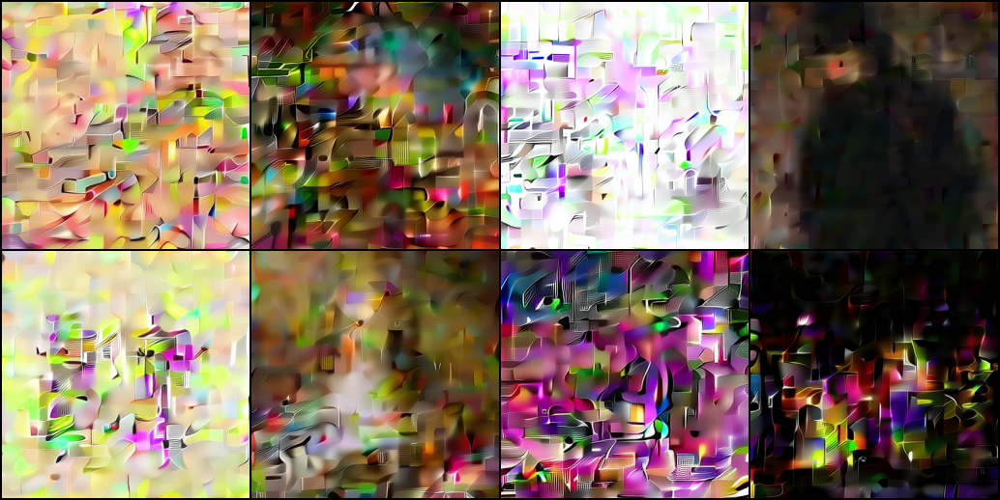
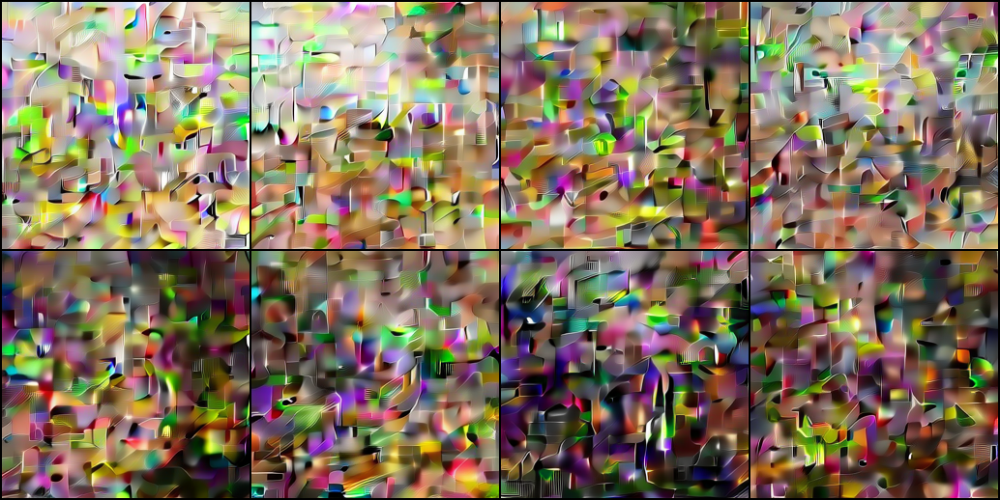
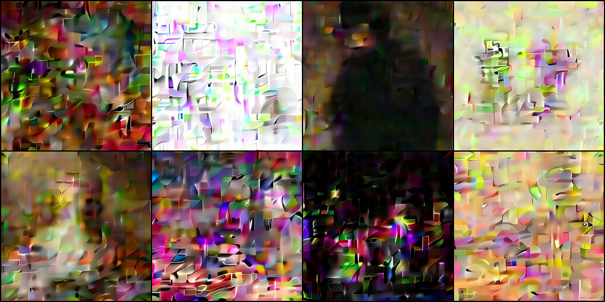

## **一、P3 本地交付与验收结论**

2026-11-10，Apple Silicon M5、24GB 统一内存，Python 3.12.14、PyTorch 2.14.1。已实现 B0 Flow 训练、采样、固定噪声诊断、Checkpoint 与恢复闭环；**P3-01～04 本地工程验收通过，P3-05 生成质量未通过，P3-06 待云端验收**。本轮停在 P4 入口，未开始 B1/B2、正式长训或云端任务。

| 任务 | 实际执行与证据 | 状态 |
| --- | --- | --- |
| P3-01 | Condition/FlowModel、线性路径与速度 MSE、条件丢弃、CFG、Euler/Heun；复用已批准的冻结 VAE/CLIP | 本地通过 |
| P3-02 | B0 8 层、384 宽、6 头、patch 2，**30,359,824** 可训练参数；[模型卡](p3/model_card.md) | 本地通过 |
| P3-03 | 二维解析路径、常速度与指数场积分、mask 独立 softmax 对照、空间手算、零初始化与梯度传播、正式形状 | 本地通过 |
| P3-04 | 真正可用的 train/sample/evaluate/cache；CPU tiny、精确恢复、有效 batch、日志修复；MPS 正式 B0 500→1000 步恢复 | 本地通过；CUDA 冒烟移入 P3-06 |
| P3-05 | 固定 16 张真实训练图，完成 1000 步；固定 8 张采样、条件与积分器对照均保存 | 实验已执行，**可辨主体门槛未通过** |
| P3-06 | 有界单卡 Pilot、吞吐/内存/成本测量入口与[执行方案](p3/cuda_pilot.md) | 入口就绪；真实 CUDA、AMP、预算审批待执行 |

初始仓库 HEAD 为 `2f8ebce`。运行身份记录该起点，同时记录实际维护源码 SHA-256，避免把本轮未提交实现误当成旧提交的代码。保护用户原有 Notebook、问答移动/删除与历史结果改动；[98 个保护文件](p3/protected_files.json) 与本轮开始时字节一致。没有修改个人 TODO，也没有将 Agent 工程实现记为个人作业通过。

## **二、工程实现与验证**

### **1. 可复用接口**

`contracts.py` → `models/plain_dit.py` → `objectives/flow.py` / `samplers/flow.py` 分别负责条件、速度模型、监督目标和积分。冻结编码器与正式缓存复用 P2。模型工厂当前只开放 B0；B1/B2 后续共享条件、缓存、配置、训练器和结果目录，不先实现它们。

训练器保存模型、EMA、AdamW、AMP scaler、日程、Python/NumPy/Torch/设备 RNG、数据排列/游标及历史日志。恢复前核对源码、PyTorch、设备、完整配方、数据/缓存和子集身份；只允许延长停止上限或改变输出目录。日志超过最后持久化检查点时，从检查点重建连续历史。原子替换避免覆盖半写入权重，运行目录加单进程互斥锁。

严格恢复已在 CPU 小案例证明：8 步连续训练与 4+4 步恢复的模型、EMA、优化器、RNG、数据游标及数值日志一致；墙钟耗时不参与相等判定。本轮 MPS 的 500→1000 是真实恢复运行，**没有声称它与独立的连续 1000 步训练逐位相同**。跨设备只支持权重加载采样，跨设备精确训练恢复不作保证。

### **2. 实际检查**

| 检查 | 结果 |
| --- | --- |
| 完整 pytest | **164 通过**，包含真实 CLI 的训练/恢复/采样/评估测试；CI 夹具不下载模型 |
| Ruff / 格式 | `src scripts tests` 全通过，70 个文件格式一致 |
| 中文接口与类型结构 | 78 个文件、384 个函数、49 个类，0 个结构问题；含历史学习路径的检查范围与 Ruff 不同 |
| CPU doctor / uv 离线锁文件检查 | 通过，无新增依赖版本 |
| 基础环境导入边界 | 屏蔽 diffusers/transformers/pyarrow 后，工程命令模块仍可导入；实际解码显式需要已安装的 latent 组件 |
| 正式缓存独立回读 | train 37,042、validation 4,637 通过；test 4,619 封存，[回执](p3/cache_readback.json) |
| 正式 B0 CPU/MPS FP32 | 相同 500 步在线权重和两条固定表示；输出最大差 **1.91e-6**、梯度最大差 **2.38e-7**，逐张量 atol/rtol=2e-4 检查通过，[回执](p3/mps_fp32_comparison.json) |
| CUDA | 不可用；Pilot 明确返回 2，未创建“通过”产物 |

原始检查摘要见 [pytest](p3/pytest_final.txt)、[Ruff](p3/ruff_final.txt)、[格式](p3/format_final.txt)、[注释](p3/annotations_final.json)、[doctor](p3/doctor_cpu.json)。历史 Notebook 的 Ruff 问题本轮未重跑或改写，不能将维护源码通过写成全仓全部通过。

## **三、本地实验与失败分析**

### **1. 固定设置和训练曲线**

ArtBench 正式 train 中以 `random.Random(20261110)` 无放回选择 16 张，固定验证集前 16 张；[样本计划](p3/sample_plan.json) 保存索引、ID 和描述。256×256 RGB、冻结 VAE mode/scaling 与 CLIP 条件全部保持 P2 身份。缓存 FP16 在计算前转 FP32，不重新生成 Caption，也不修改正式划分。

正式 B0，MPS FP32，seed=0，微批 4，累积 1，AdamW 峰值 LR=1e-4、WD=0.01、梯度裁剪 1、条件丢弃 0.1、EMA=0.99；20 步 warmup，固定 1000 步余弦日程。500 步诊断后只把停止上限延长到 1000，未更改日程或模型。两个调用均有 1800 秒安全上限，实际循环累计 **151.465 秒**（含循环内验证和周期保存；不含加载、采样及最后保存）。收费 GPU/API 实际支出 **0 元**。

| 观察量 | 实测 |
| --- | ---: |
| 首 20 步平均随机目标损失 | 1.698955 |
| 481–500 步平均损失 | 0.891839 |
| 981–1000 步平均损失 | 0.751895 |
| 500 步累计循环时间 | 76.848 秒 |
| 1000 步累计循环时间 | 151.465 秒 |



[500 步曲线](p3/training_curve_500.png) · [完整逐步日志](p3/metrics.jsonl) · [实际配置与身份](p3/run.json) · [停止原因](p3/result.json)。时间是本机观察值，不是 CUDA 吞吐或正式全量训练报价。

### **2. 条件对照**

以下均为相同固定噪声、时间、EMA、16 条表示的速度 MSE，seed=20261110；数字来自 [逐样本评估](p3/condition_evaluations.json)。空条件使用真实空文本编码与掩码，打乱条件采用循环移位。

| 步数 / 划分 | 正确文本 | 空文本 | 打乱文本 |
| --- | ---: | ---: | ---: |
| 500 / train 子集 | 0.855275 | 0.999083 | 1.393154 |
| 500 / validation 子集 | 1.040006 | 0.981137 | 1.109879 |
| 1000 / train 子集 | 0.660660 | 0.968454 | 1.783612 |
| 1000 / validation 子集 | 1.279334 | 0.987934 | 1.363669 |

训练子集正确条件收益增加，同时验证子集正确条件弱于空条件，且比 500 步退化。说明模型已经利用训练文本，但这种利用没有形成已验证的泛化或图像语义质量。样本很少、验证为前缀、训练只有一个种子；不报告统计显著性，也不把 MSE 当成条件遵循率。

### **3. 完整采样与所见问题**

所有图使用固定 8 条预登记提示与 seed=20261110，不挑选“成功案例”；CFG=1、Euler 40 次求值，从时间 0 完整积分到 1。Heun 20 步也为 40 次速度/主干求值。原始逐图 PNG、潜变量和元数据保留在 `artifacts/runs/p3_samples_*`，[完整生成记录](p3/sampling_records.json) 绑定检查点 SHA-256、条件来源、实际 NFE、设备和未预热耗时。









Agent 逐张查看以上四组，以及 500 步在线权重和 1000 步等 NFE Heun 两组，合计 48 张生成图。主要问题是矩形块状重复纹理、异常高频线条和彩色噪声，人物和场景主体不可辨。文本会改变整体色调和明暗，但不构成可控主体生成。500 步在线权重没有解决 EMA 图像失败；1000 步 Heun 也未带来可辨结构。本轮不是用户人工验收，未给出虚构的人工评分。

诊断证据支持：学习尚不充分，训练子集条件记忆与验证退化并存。独立解析积分、patch 手算、mask/梯度、缓存身份、FP32 对照未发现方向或数值实现错误，但不能据此断言所有实现都无误，也不能仅凭图像纹理把根因归给 VAE。没有替换 VAE、改变分辨率或剔除 ArtBench 样本。**P3-05 质量项保留未通过；没有超出 1000 步继续搜索参数。**

## **四、复现入口和产物**

所有命令从仓库根运行，先准备现有 uv 环境及 P2 的本地资产。已有目录不会被新训练覆盖；重做实验请复制配置并修改 `training.output_dir`。以下是本轮真实命令形式，不自动执行下一阶段。

```bash
# 数学、模型、训练器与 CLI 的独立 CPU 验证，无模型下载
uv run --locked --offline --no-sync pytest -q -p no:cacheprovider
uv run --locked --offline --no-sync minigen doctor --device cpu --json

# CPU tiny 入口；规格明显标为 tiny，不能替代正式 B0
uv run --locked --offline --no-sync minigen train --config configs/training/p3_tiny.json --device cpu

# 正式 B0 的有界本地实验与同设备恢复
uv run --locked --offline --no-sync minigen train --config configs/training/p3_local.json --device mps
uv run --locked --offline --no-sync minigen train --config configs/training/p3_local_extended.json --device mps --resume artifacts/runs/p3_local/step_000500.pt

# 500 步快照在续跑前由 last.pt 复制保留；自动保留的是 0、100 和 last
# 首次复现也可直接从 500 步完成时的 last.pt 恢复
uv run --locked --offline --no-sync minigen sample --config configs/training/p3_local_extended.json --checkpoint artifacts/runs/p3_local/last.pt --output artifacts/runs/p3_reproduce_samples --device mps --seed 20261110 --count 8 --steps 40
uv run --locked --offline --no-sync minigen evaluate --config configs/training/p3_local_extended.json --checkpoint artifacts/runs/p3_local/last.pt --output artifacts/runs/p3_reproduce_eval.json --device mps --seed 20261110 --split train --count 16 --condition-mode correct
```

`sample` 可设 `--weights model`、`--condition-mode blank|shuffled`、`--method heun --steps 20`，或通过 `--prompts` 读取 JSON 字符串列表并离线编码。`evaluate` 只提供固定配对速度 MSE；正式 P5 指标尚未实现。CUDA Pilot 命令、成本字段和未实现的多卡边界见 [P3-06 说明](p3/cuda_pilot.md)。

Git 只提交源码、配置、测试、必要的小型日志/元数据及报告图；权重、原始数据、正式表示缓存和逐样本临时产物留在忽略目录。没有推送远程。

## **五、P4 入口与唯一下一任务**

用户本轮明确调整执行顺序为“先完成 P3–P5 主体代码和本地小实验，再统一上云正式训练”。下一轮由用户启动 **P4 的工程范围确认及 B0 失败诊断收尾**，之后接入 B1/B2；本轮不自动开始。可直接复用条件契约、冻结缓存、配置工厂、目标、积分器、训练器、恢复和统一结果目录。

后续仍需：缩小诊断变量以确认短训失败原因；在质量与 Caption 噪声决定后，分别完成 B1/B2 模型、参数量/mask/位置/梯度/恢复测试；在新授权的 CUDA 环境验收 AMP、吞吐和预算。正式 B0/B1/B2 长训与 P5 图像质量指标、Benchmark 冻结、完整云端操作手册均未执行。不把当前工程闭环当作三模型研究完成。

## **六、后续收尾记录**

2026-11-10 新增 [P3 收尾报告](03_p3_closeout.md)，单图过拟合可辨、固定 16 图学习率对照仍未达到质量门槛；本报告中的原实验结果保持其历史身份。P4 主体工程及三模型本地验收另见 [P4 交付](04_p4_delivery.md)，当前下一步以 [交接](00_handoff.md) 为准。
