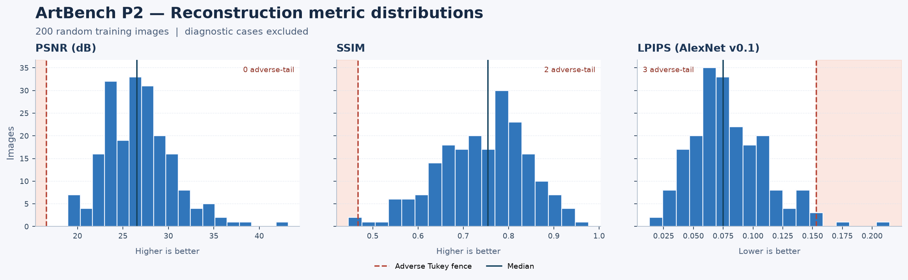

## **一、审查结论与阅读路径**

**初步建议：保留当前 SDXL VAE 作为普通绘画生成的候选，暂不更换；等待用户最终视觉验收。** 原图与重建的对照中，主体、主要色块和整体布局总体保留；密集排线、纸纹、细小字形、远景人物或细枝等局部内容可能被抹平或融合。当前证据没有显示反复出现的主体结构崩坏或大面积颜色错误，也不足以宣布所有题材都通过。若目标包含可读文字、精确计数或高保真细线，现有对照已显示实质风险。

| 审核入口 | 用途 |
| --- | --- |
| [200 张对照网页](vae_200_contact_sheet.html) | 固定抽样顺序，支持三指标排序、查找 ID、统计异常与最差 20 筛选；点击图片或「并排放大」可查看 1×/2×/4× |
| [9 张细节诊断](vae_9_outliers.html) | 重点查看边缘、色彩与稀疏细节；包含原图、重建和同坐标局部 |
| [LPIPS 最差 20 张](vae_lpips_worst20.html) | 避免只看均值；从随机 200 中按 LPIPS 降序选出 |
| [200 张 CSV](vae_metrics.csv) · [9 张 CSV](vae_9_diagnostics.csv) · [分布图](vae_metrics_distribution.png) | 复算统计、异常标记和关键词覆盖；9 张不混入总体 |
| [统计结构化结果](stats.json) · [实现与文件身份](review_provenance.json) | 指标定义、类别规则、源文件摘要和独立校核 |

先完整解压 ZIP，再在普通浏览器打开 HTML。图像、样式和交互均在包内，无需联网。放大仅扩展 256×256 的已有像素。此包只交付审核依据；没有批准 VAE、没有更换模型、没有构建正式 Latent Cache，也未启动训练。

## **二、随机 200 张的全量统计**

样本源为 ArtBench Public Domain 256x256 `v1`，固定 revision `4056b70025f0e3f916fb271c7a792633ba637484`。冻结清单有 46,298 张，其中训练切分 37,042 张。按训练行的 `sample_id` 排序，使用 Python `random.Random(20261107).sample` 均匀无放回取 200 张；包内证据对照清单重现了 **200 个 ID 及其顺序**。该抽样不按类别配额，训练之外的验证和测试图像不参与。9 张诊断来自其余训练行另抽的 256 张候选，不进入下表、分布图或尾部排名。

### **1. 指标分布和统计异常**

PSNR、SSIM 越高越接近参考图；LPIPS 越低越接近参考图。标准差为样本标准差（ddof=1）；分位数采用线性插值，200 张三指标均有限。

| 指标 | 均值 | 中位数 | 标准差 | 最小值 | 最大值 | P5 | P25 | P75 | P95 |
| --- | ---: | ---: | ---: | ---: | ---: | ---: | ---: | ---: | ---: |
| PSNR（dB）↑ | 26.7553 | 26.5156 | 3.7863 | 18.9510 | 43.2046 | 21.3904 | 24.0109 | 28.9753 | 33.5363 |
| SSIM ↑ | 0.7438 | 0.7547 | 0.0998 | 0.4463 | 0.9767 | 0.5722 | 0.6754 | 0.8138 | 0.8922 |
| LPIPS（AlexNet v0.1）↓ | 0.0800 | 0.0749 | 0.0311 | 0.0131 | 0.2146 | 0.0384 | 0.0596 | 0.0970 | 0.1408 |

采用单侧 Tukey 规则标记分布中较差的一尾。对 PSNR 和 SSIM 使用低于 $Q_1-1.5(Q_3-Q_1)$ 的值，对 LPIPS 使用高于 $Q_3+1.5(Q_3-Q_1)$ 的值。四分位数采用线性插值。PSNR 低于 16.564218 dB 的有 0 张，SSIM 低于 0.467841 的有 2 张，LPIPS 高于 0.153252 的有 3 张。合计 4 个不同样本，`ab-07868` 同时命中 SSIM 和 LPIPS。围栏用于找复核案例，正式通过条件仍取决于图像中的实际损失。

| 异常候选 | PSNR（dB） | SSIM | LPIPS | 命中不利尾部 |
| --- | ---: | ---: | ---: | --- |
| [ab-05817](vae_200_contact_sheet.html#ab-05817) | 22.4045 | 0.4483 | 0.1461 | SSIM |
| [ab-07868](vae_200_contact_sheet.html#ab-07868) | 19.8404 | 0.4463 | 0.1707 | SSIM、LPIPS |
| [ab-31066](vae_200_contact_sheet.html#ab-31066) | 24.6063 | 0.4858 | 0.2146 | LPIPS |
| [ab-27489](vae_200_contact_sheet.html#ab-27489) | 23.9648 | 0.5868 | 0.1572 | LPIPS |

### **2. 类别覆盖与差异的证据范围**

当前冻结源提供作品图片、自动生成的描述、作者和来源 URL。源表和清单没有经核验的逐图体裁或画派标签。用冻结后的英文 Caption 做透明、可复算的关键词匹配，结果仅表示文本提及相应词语。8/200 命中明确体裁词，其中肖像 1、风景 4、静物 1、城市／街景 2，192 张无体裁词匹配。这个覆盖率与各组规模不足以判断真实体裁之间的差异。

为便于安排人工复核，另统计人物、植物、水域、建筑、动物五组常见主题词。189/200 至少命中一组，87/200 命中多组，11/200 未命中。每组统计使用同一 200 张抽样集。

| Caption 主题词 | n | PSNR 中位数（dB） | SSIM 中位数 | LPIPS 中位数 |
| --- | ---: | ---: | ---: | ---: |
| 人物词 | 151 | 26.4377 | 0.7588 | 0.0740 |
| 植物词 | 77 | 25.7964 | 0.7035 | 0.0920 |
| 水域词 | 27 | 26.4606 | 0.7464 | 0.0867 |
| 建筑词 | 34 | 24.5667 | 0.6911 | 0.0963 |
| 动物词 | 24 | 26.5131 | 0.7086 | 0.0778 |
| 无匹配 | 11 | 28.2592 | 0.8051 | 0.0572 |

建筑词组的三项中位数都比未命中建筑词的 166 张差，后者为 26.8625 dB、0.7682、0.0731。植物词组有相同方向的差距。主题词可能遗漏、错标或共现，内容密度和笔触也可能影响指标。现有结果只支持优先复核这些样本，无法据此归因到题材或画派。逐行证据中的 `tags`、`subject_tags` 和对应的 evidence 列保留匹配词，`stats.json` 提供规则和每组分布。

### **3. 线描、媒介和文字的补充线索**

仍以同一 200 张的冻结英文 Caption 做词汇匹配，不直接把词汇当成画面事实。具体匹配规则、命中的样本和非命中对照见 [线描、媒介与文字探索](caption_medium_exploration.json)。

| 文本线索 | 命中数 | PSNR 中位数（dB） | SSIM 中位数 | LPIPS 中位数 |
| --- | ---: | ---: | ---: | ---: |
| 提及文字、字词、题字或书法 | 30 | 24.1349 | 0.7453 | 0.0727 |
| 明确线描、素描或版画词 | 29 | 24.1307 | 0.7350 | 0.0713 |
| 明确油画词 | 1 | 22.6925 | 0.6569 | 0.1057 |

前两组的 PSNR 和 SSIM 中位数比各自未命中组低，LPIPS 中位数却略低（更相似），这也提醒不能靠同一个指标判断文字或线条是否忠实。关键词未命中不代表画面不含文字或不属于该媒介。油画组只有 1 张，无法做组间质量比较。真正的细字、线描退化以第三章的图像配对为证据。

## **三、逐图视觉复核**

### **1. 诊断队列：9 张高风险样本**

这 9 张来自随机 200 张之外的训练集候选池，按原图的边缘密度、色彩跨度、稀疏高反差细节代理各筛 3 张。它们用于主动查找失真，**不计入随机 200 张指标和任何总体通过率**。下表逐张查看了原生 256×256 的原图与重建，及同坐标放大图。裁剪框为原图坐标 `(x1, y1, x2, y2)`：在边长 64、步幅 32 的候选窗口中选择 RGB 平均绝对误差最大的一处，再用最近邻放大；这只说明该处像素差较大，并不等于语义上最重要或损坏最严重的位置。整图检查用于补足热点裁剪的局限。

指标顺序为 **PSNR（dB）↑ / SSIM ↑ / LPIPS AlexNet v0.1 ↓**。等级按本轮普通绘画生成判断：轻微表示变化集中在纹理或局部边缘；明显表示可辨的线条、花纹或笔触发生退化；无法使用表示目标要求的关键信息已不可辨。等级是本次可视复核结论，尚未得到用户批准。

| 图像与选取依据 | 指标 / 细节框 | 可见变化与严重度 | 对主体辨认与后续 DiT 的可能影响 |
| --- | --- | --- | --- |
| [ab-22415](vae_9_outliers.html#ab-22415) · 密集边缘 | 14.85 / 0.6075 / 0.1454；`(192,128,256,192)` | **明显**：右侧站立人物的衣甲边缘及几何花纹出现线条变粗、相邻黑线黏连；原图浅色留白和排线之间的界限更清楚。 | 人物、柱座及相对位置仍能辨认。要求复现精细排线或衣甲花纹的提示词可能受限。 |
| [ab-10508](vae_9_outliers.html#ab-10508) · 密集边缘 | 17.70 / 0.8018 / 0.0554；`(192,32,256,96)` | **轻微**：右上人物头部后方的印刷排线与黑白颗粒变软，局部条纹间隔略模糊；高反差粗线基本保留。 | 中间人物的眼镜和面部轮廓、人物并排布局仍清楚。低 PSNR 在这里未对应明显的主体识别损伤；印刷纹理仍可能受限。 |
| [ab-02054](vae_9_outliers.html#ab-02054) · 密集边缘 | 17.07 / 0.5362 / 0.1265；`(32,32,96,96)` | **明显**：左上树冠及浅色天空交界处的细枝叶变团，枝叶间小亮缝变窄或黏合。 | 斜树干、树林和左下小人物仍能定位；局部枝条结构与细密版画感不宜作为高保真目标。 |
| [ab-16576](vae_9_outliers.html#ab-16576) · 高色彩跨度 | 27.80 / 0.8149 / 0.0456；`(64,192,128,256)` | **轻微**：粉色衣袖和下沿黄褐色线簇交界略钝，细线变软；黄色背景和粉衣主体色块未见明显互换。 | 人像、朝向和衣服主色仍可辨，宽泛的颜色与主体条件具备可表达的视觉基础；细笔描线可能变软。 |
| [ab-29291](vae_9_outliers.html#ab-29291) · 高色彩跨度 | 29.73 / 0.8260 / 0.0457；`(0,192,64,256)` | **轻微**：画面左下的亮黄衣领条纹与橙红纹理交界略平滑；浅黄面部、暗橄榄色头发与背后橙绿区域仍有清楚区分。 | 侧脸轮廓和主要色块保留。靠重复细条纹区分具体衣饰时，重建能提供的信息较少。 |
| [ab-01111](vae_9_outliers.html#ab-01111) · 高色彩跨度 | 26.87 / 0.5892 / 0.0729；`(32,96,96,160)` | **明显**：左侧橙黄色外衣中绿色褶线依然可见，但线间小重复花纹和颜料颗粒明显弱化；深蓝背景也变平滑。 | 大面积橙黄、深蓝、黑及衣身轮廓保留；若提示词要求辨认重复织纹，不能用大色块保留推断其已满足。 |
| [ab-37998](vae_9_outliers.html#ab-37998) · 稀疏高反差细节 | 31.41 / 0.9412 / 0.0254；`(128,128,192,192)` | **轻微**：浅底图中央器皿状轮廓的右侧，浅蓝裂纹局部对比降低、边缘变钝；轮廓主线和附近小色标仍可见。 | 稀疏线稿并非一律失效；主体和大的线条关系保留，但裂纹的精细拓扑不能由此保证。 |
| [ab-45878](vae_9_outliers.html#ab-45878) · 稀疏高反差细节 | 29.51 / 0.8989 / 0.0422；`(160,192,224,256)` | **轻微**：画面右下白色衣饰与青绿色区域交界的短笔触略柔化，深色帽檐与脸部明暗分界基本保持。 | 人像、帽子和大色块仍可辨。细笔触变钝不支持进一步推断人脸辨识、身份或精细材质保真。 |
| [ab-23954](vae_9_outliers.html#ab-23954) · 稀疏高反差细节 | 31.88 / 0.9234 / 0.0338；`(128,64,192,128)` | **轻微**：受光面部的眼周皱纹、眉眼和发丝边缘略变软；深色外套与暗红背景整体仍清楚。 | 坐姿人物和大致表情可辨；微表情、面部身份特征及其可控性没有在本项得到验证。 |

**诊断小结：** 按上面的任务口径，9 张中记录为 **3 张明显、6 张轻微**，未观察到整图主体无法使用的例子。密集排线及重复高频纹理是最一致的风险；色彩跨度大本身没有导致主要颜色丢失。此处检查的是固定 VAE 的编解码瓶颈，未运行 DiT；对训练的描述只指出潜在表示限制，不能当作真实生成、提示词遵循或可控性结果。用户审核仍待完成。

### **2. 随机样本中的 LPIPS 最差 20 张**

[打开 LPIPS 最差 20 张原图／重建／同坐标局部对照](vae_lpips_worst20.html)。从 **200 张随机训练图** 的逐图结果按 LPIPS 从高到低选取，9 张诊断图不参与排序。LPIPS 范围为 **0.122215–0.214646**；与 SSIM 最差 20 张重叠 **15 张**，与 PSNR 最差 20 张重叠 **6 张**。例如 PSNR 最差的 `ab-25839` 不在 LPIPS 最差 20 张内。指标各自用于定位差异，不能凭某个名次判断整张图是否可用。

已逐对查看下列 20 张的完整图和局部放大图。反复出现的是密集笔触、纸纹、排线或枝叶被平滑；部分小人物、枝条或花瓣发生局部黏连。主体、大色块与整体布局在这 20 对里总体保留，未见重复发生的主体消失或大色块换色。若要求底边细字可读、版画排线或远景人物精确复现，下面若干图已经暴露出组件能力上限。局部图是按像素误差选出的窗口，不能覆盖全图所有风险；这批定向选例也不能估计随机样本的视觉失败比例。

| 排名 | 样本 | LPIPS | 对照中可见的变化 |
| ---: | --- | ---: | --- |
| 1 | `ab-31066` | 0.214646 | 线稿人物和盾形轮廓保留；规则网点减弱，盾面纹样与人物内部排线变软。 |
| 2 | `ab-07868` | 0.170670 | 山、湖和路的布局保留；前景密草与彩色短笔触被平滑。 |
| 3 | `ab-27489` | 0.157157 | 花簇主色与位置保留；下方深红花的层叠花瓣并成更均匀的色块。 |
| 4 | `ab-19167` | 0.152546 | 中景人形与前景图案仍在；弧形装饰的点阵、条纹变宽，局部细线黏连。 |
| 5 | `ab-19483` | 0.147566 | 林间树干、阴影与道路保留；右上方的小枝叶和细亮线变淡。 |
| 6 | `ab-20758` | 0.147077 | 盔甲人物与暖色光保留；胸甲密集鳞片的轮廓变粗，亮斑与分隔线改变。 |
| 7 | `ab-05817` | 0.146073 | 人物轮廓、姿态和田地布局仍可辨；草地密集的彩色颗粒变软。 |
| 8 | `ab-29446` | 0.141783 | 建筑、街面与人群位置保留；远处小人物的头肩边界变糊，局部人物轮廓更难分辨。 |
| 9 | `ab-44150` | 0.141700 | 树干和阴影结构保留；暗部树叶的碎亮笔触与细枝更模糊。 |
| 10 | `ab-25935` | 0.141362 | 崖壁、街面和建筑颜色仍清楚；街面小人和物件的窄边局部并合。 |
| 11 | `ab-03892` | 0.140813 | 树木、坡地和高饱和色块保留；右侧细树干周围的笔触边界变软。 |
| 12 | `ab-40685` | 0.139867 | 船体和远处建筑的大形保留；水面碎亮笔触和背景的细划痕弱化。 |
| 13 | `ab-34514` | 0.137550 | 前景人物与马车轮廓仍在；远处人物、树干和街面笔触更容易连成一片。 |
| 14 | `ab-28443` | 0.134541 | 黑白版画的版式和人物仍在；下方原本部分可辨的细字变形，花边内的细线更难分开。 |
| 15 | `ab-23266` | 0.132533 | 塔楼、雪地和人群布局保留；前景小人边界与成簇细枝变钝，局部黏连。 |
| 16 | `ab-05275` | 0.126770 | 前景两名人物与桌面仍清楚；右上背景碎色、花叶与竖向小线条变软。 |
| 17 | `ab-22426` | 0.125313 | 抬手人物的姿态保留；下方前景的细排线、纹理和小边缘减弱。 |
| 18 | `ab-34332` | 0.124704 | 帆船和码头的位置保留；右侧码头的细支撑、附近水波笔触变粗。 |
| 19 | `ab-13165` | 0.123226 | 人物、花瓶和暖色室内布局保留；深红花瓣、细花茎和背景花纹边缘变软。 |
| 20 | `ab-37833` | 0.122215 | 建筑与前景构图保留；平台亮色小人的四肢和栏杆细纹更难辨清。 |

建议优先由复核者并排看 **`ab-31066`（线稿）、`ab-28443`（细字）、`ab-29446` 与 `ab-23266`（小对象）**，并根据实际训练目标判断这些细节损失是否可接受。以上是 Agent 初筛意见，未代替用户对 P2-02 的批准。

### **3. 交叉指标与常规案例**

为了补足按 LPIPS 单一指标定位的偏差，另复核 PSNR 最差两张（均不在 LPIPS 最差 20）：

- [ab-25839](vae_200_contact_sheet.html#ab-25839)（18.951 dB、SSIM 0.6470、LPIPS 0.1103）：彩色玻璃窗的拱形、窗格、大色块和人物构图仍在；部分细窗格和人物面部边缘变粗，微细黑白图案变得更均匀。
- [ab-25761](vae_200_contact_sheet.html#ab-25761)（19.069 dB、SSIM 0.7383、LPIPS 0.1011）：海报版式和边框颜色仍在，但多行原本可读的小字重建成伪字形。**若任务要求文字逐字准确，该例不可用**。它没有进入 LPIPS 尾部 20，说明单独依赖该指标会漏掉某些任务关键损失。

为避免只看困难图，还按 LPIPS 从低到高排序，在前三个四分位区间中各固定抽看 4 张（`random.Random(20261107)`，共 12 张，无重叠）。[ab-01834](vae_200_contact_sheet.html#ab-01834) 的主体与衣服主色、[ab-37082](vae_200_contact_sheet.html#ab-37082) 的屋顶与梯子骨架均保留；[ab-39602](vae_200_contact_sheet.html#ab-39602) 的细字仍有变形，[ab-25184](vae_200_contact_sheet.html#ab-25184) 的衣饰细纹趋平。其余复核 ID：`ab-12938`、`ab-01098`、`ab-13754`、`ab-21100`、`ab-02783`、`ab-42244`、`ab-06160`、`ab-21375`。本轮共详细观察了 **43 组不重复配对**（9 压力 + 20 LPIPS 尾部 + 2 PSNR 补充 + 12 常规），自动指标覆盖 200 张随机图。因人工查看设计偏重尾部，以上不能折算为 200 张的视觉通过率。

## **四、VAE 配置与实现核对**

| 检查点 | 本轮核对结果 |
| --- | --- |
| 模型与权重 | `madebyollin/sdxl-vae-fp16-fix`，revision `207b116dae70ace3637169f1ddd2434b91b3a8cd`。实际本地 config 和 `diffusion_pytorch_model.safetensors` 的大小、SHA-256 均匹配锁。Safetensors 文件 334,643,238 字节，头部列出的 248 个张量均为 F32。模型名中的 `fp16-fix` 不表示本次以 FP16 推理。 |
| 设备与精度 | 原审计为 CPU FP32、PyTorch 2.14.1、Diffusers 0.42.0，模型冻结且处于 eval，无 FP16、BF16 或自动混合精度。读取原始张量确认 shape `[209,3,256,256]`、dtype `torch.float32`，没有 NaN 或 Inf。只核实已运行的配置；未评估未来低精度路径。 |
| 输入 | 核对 209 张 JPG 的 SHA-256、RGB、256×256 与冻结清单相同，未 resize、裁切或增强。uint8 先映射到 [0,1]，再以 `2x−1` 送入编码器。外审 ZIP 中的原图 JPG 逐字节复制，无重新压缩。 |
| 后验与缩放 | 使用对角高斯后验的 `latent_dist.mode()`（等于后验均值），没有采样噪声；输出为 `[b,4,32,32]`。编码乘 `0.13025`，解码前除同一系数。原审计首批逆缩放与编码器直接均值对照最大绝对误差为 9.54×10⁻⁷；迁移后的正式适配器此前复跑 4 张，原始解码结果逐位一致。 |
| 解码与显示 | Decoder 原始输出为 −1.22014 到 1.19924；158,434 / 41,091,072 个 RGB 标量（0.3856%）超出 [−1,1]。原始张量保留，指标和网页才裁剪到 [−1,1] 并映射到 [0,1]；这会影响极端亮暗值，是明示的指标口径。 |
| 保存与指标 | PSNR、SSIM、LPIPS 在裁剪后的 FP32 像素上计算，不读取 PNG。网页 PNG 才四舍五入到 8 位，显示量化本身的 RGB RMSE 约 0.001130（[0,1]）；未叠加有损压缩。包内 209 对显示图与原审计逐像素一致；从原始张量与源图独立复算 PSNR，最大差 3.81×10⁻⁶ dB。 |

指标口径：PSNR 以 data range 1 对 RGB 全图计算；SSIM 用 11×11 Gaussian（σ=1.5），逐通道、有效窗口后平均；LPIPS 采用固定 v0.1 AlexNet 和已核验校准权重，无分类或文本匹配。统计与视觉只说明该 VAE 在这批图上的表示保真度。此轮未重跑 200 张 VAE；审查依赖已保存的原始张量、锁定资产、源图以及实现代码。本轮没有发现归一化、精度选择、后验、缩放或指标保存路径的实现错误。局部软化与固定压缩组件的能力上限相容，但没有单独改变分辨率、VAE、精度或后验的对照，不能把所有偏差归因给某一项。

## **五、对后续 MiniGen 的影响与用户验收项**

| 用户关心的问题 | 初步判断 |
| --- | --- |
| 整体重建质量如何？ | 主体、构图和大色块在已审案例通常保留；随机 200 的分布显示仍有明显长尾，不能只看均值。没有预设的通用及格线。 |
| 失真主要集中在哪些图？ | 可见问题集中在细密线稿、印刷或网点纹理、小字、密集枝叶与远景小对象；建筑与植物主题词组出现更差的描述性中位数。缺少可靠体裁或媒介标签，不能判定整个油画、风景、建筑或某个画派的真实失真率。 |
| 是否系统性？ | 高频细节软化和线条融合在不同实例中反复出现。未在已查看的案例中发现持续的主体消失、全局几何错位或大面积色相置换；样本覆盖不足以排除罕见失效。 |
| 是否来自数值精度或实现错误？ | 对实际 CPU FP32、缩放、显示和 PSNR 路径没有发现实现异常；没有测试 FP16/BF16，也未做替代编码路径的因果对照。 |
| 是否已有换 VAE 的充分证据？ | 对普通绘画语义、色块和整体布局，证据不足以要求换。若可读文字、细线拓扑或小物体识别是硬指标，已看到与目标冲突的例子，应先按该目标做专项验收。 |
| 对 256×256、30M/50M 文本条件 Latent DiT 的风险？ | 固定 VAE 把画面变成 4×32×32；若潜表示或解码器不能可靠传递关键文字、微纹理、小对象边界与计数，更大的 DiT 也没有由本结果证明可以恢复。此轮没有训练 30M/50M，也没有测量提示词遵循。 |

人工审核建议：先看 [9 张细节诊断](vae_9_outliers.html) 和 [最差 20](vae_lpips_worst20.html)，再到 [200 张对照](vae_200_contact_sheet.html) 切换 PSNR/SSIM 排序并抽看中位附近。重点记录 **主体、轮廓、关键颜色、计数／关系、细线、小字** 是否影响你实际要生成的内容；可将例图分为「轻微／明显／目标不可用」，并记录样本 ID 和具体条件。**最终验收：待你决定。** 本轮到这里暂停。
