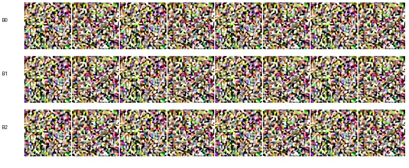
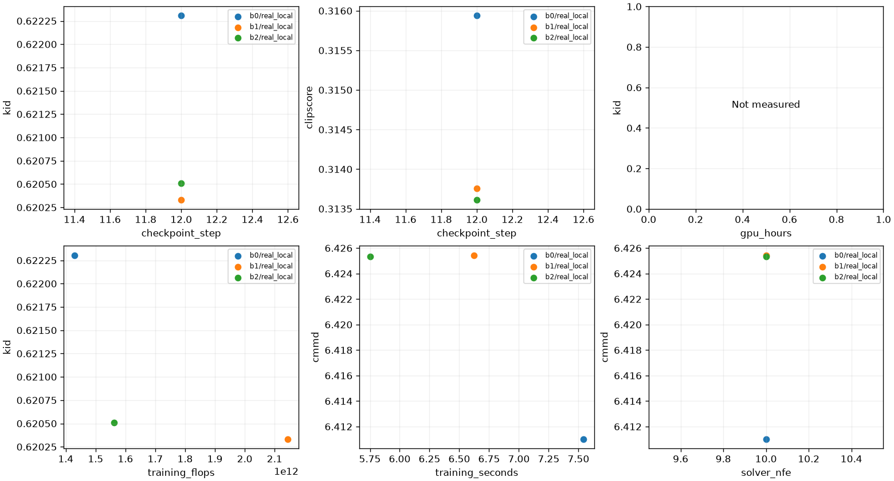
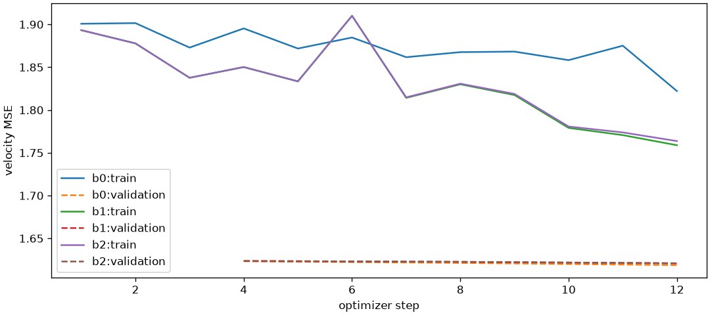
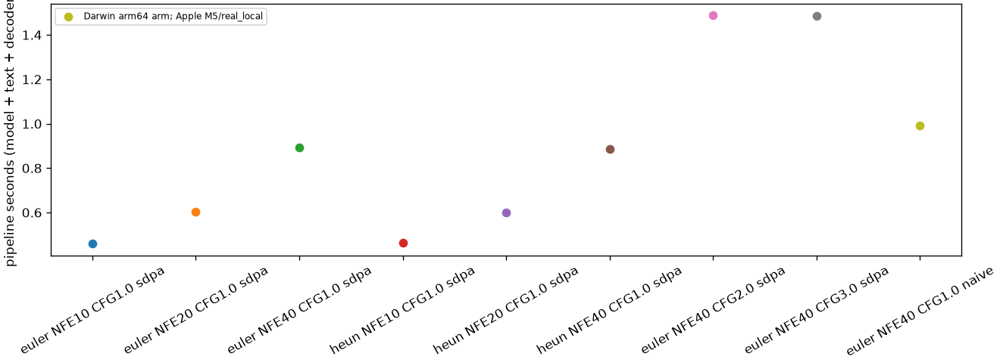

## **一、运行范围与真实输入**

2026-11-10，Apple M5、24GB 统一内存，PyTorch 2.14.1，MPS FP32 推理。复用 P4 的三个 step=12 工程检查点，本轮 **没有训练**。B0 30,359,824 参数，B1/B2 各 30,061,456；三者参数和模型规格未修改。

每模型使用独立验证题中的前 4 条 × seeds 20261112/20261113，Euler、solver NFE=10、CFG=1，共 24 张原生 256×256 PNG。该 4 题来自 girl 语义族的数量/颜色/位置变体，是固定 smoke，不宣称多类别覆盖。分布参考为 16 张固定 validation 图片；没有对 2,000 张正式 Test reference 提取特征、生成或评分。

完整任务/图像哈希/检查点/评测器版本见本目录的各模型 samples/scores JSON；KID/CLIP 评测权重与生成条件文本塔分开。首次十条端到端命令实际 92.756 秒；设备数值对照 25.223 秒。重入、最终评分实现复核另见 [回执](p5/final_rescore.json)，没有接近本地 30 分钟推理上限。安装下载不计入此推理上限，GPU/API 收费为 0 元。

## **二、指标与质量边界**

| 模型 | 有效/预期 | KID mean ± std | CMMD | CLIPScore L/14@336 | 双种子 LPIPS |
| --- | ---: | ---: | ---: | ---: | ---: |
| B0 | 8/8 | 0.622306 ± 0.035123 | 6.411014 | 0.315938 | 0.453564 |
| B1 | 8/8 | 0.620332 ± 0.035022 | 6.425449 | 0.313759 | 0.454174 |
| B2 | 8/8 | 0.620511 ± 0.035033 | 6.425341 | 0.313614 | 0.454168 |

KID 此处仅 **10 次 × 4 样本**，保留逐次估计，标准差为抽样标准差而非训练重复误差；正式口径仍为 100×1000，不被烟测覆盖。CMMD 为单位 CLIP 投影的 biased RBF MMD²×1000，带宽 10；CLIPScore 无前缀、2.5×max(cosine,0)。LPIPS 每模型只有 4 对，体现初噪差异，不能独立证明有效多样性。

**24 张图均仍表现为噪声纹理，没有可辨主体。** 主 Agent 查看了全部 24 张缩略图，并在浏览器检查匿名页首屏和实际图像加载。没有给出正式人工评分或架构排名。小指标差异不能证明 B0/B1/B2 优劣，更不能解除 P3-05 的质量门槛。



原始 PNG：`artifacts/evaluations/p5/smoke/b0/`、`b1/`、`b2/`。原尺寸画廊：`artifacts/evaluations/p5/smoke/report_final/gallery.html`。缩略图使用必要尺寸压缩，指标计算始终读取原始 PNG。

## **三、评测器、恢复与性能**

固定样本为 ab-06191、ab-27518，仅来自 validation。预设最大绝对误差 5e-4，未根据结果调整：Inception CPU/MPS 最大 4.53e-6；CLIP 图像 2.09e-5；CLIP 文本 5.25e-6。batch=2 与 batch=1 对照均通过。[数值回执](p5/backend_parity.json)

B2 生成任务以 batch=1 重入，8 图哈希和顺序保持，渲染批次数仍为 4，没有新采样；尝试时间改变会更新 samples 回执哈希，因此额外生成与新清单绑定的评分，不覆盖旧分数。[恢复回执](p5/resume.json)

九组实际 MPS profile 均完成；每组 2 张固定初噪图，预热 1 次、计时 2 次。主干去噪和包含文本编码/解码的 pipeline 耗时分开，模型加载及写盘另计。Euler10 CFG1 pipeline 约 0.459 秒，Euler40 CFG1 约 0.891 秒，Heun20 步（solver NFE40）约 0.887 秒，Euler40 CFG2 约 1.489 秒，naive Euler40 CFG1 约 0.992 秒。CFG2/3 的实际主干求值为 80，不能与 CFG1 的 40 次当同计算预算。[逐次测量](p5/profile.json)

这里是同一 Mac 的小批量推理测量，没有 CUDA GPU hours/峰值显存/AMP 结论。MPS 当前内存不是峰值。训练 FLOPs 图来自已有 P4 前向形状计数乘 3 和检查点真实样本数，仅为主导矩阵运算近似；排除 optimizer/EMA/非矩阵算子/冻结编码器，不是硬件实测。







同更新 step=12 的三份已有回执可配对，但只是工程对照；正式质量—预算结论未执行。CUDA 轴保持空白；没有插造中间检查点或收费账单。[结构化汇总](../final/p5_local_summary.json)

## **四、人工页面与 VQA**

离线盲评页面包含全部 24 张图片，按固定种子匿名化排序；浏览器读取到 24/24 图像成功加载、0/24 已记录。8 张真实 validation + 8 张人为退化校准页也已展示首屏，保持 0/16，未输入或导入任何真实人工答案。Python 导入/导出往返、伪造身份/错误字段/漏项、未知答案及失败分母另由显式测试夹具检查。

- 盲评：`artifacts/evaluations/p5/smoke/blind_review/review.html`。
- 8+8 工具检查：`artifacts/evaluations/p5/calibration/review/review.html`。
- 本轮 VQA 只运行显式 Mock 和真实适配器调用契约测试。默认 Mock 返回 unknown，结果标 simulated，不进入上述真实指标表。[模拟回执](p5/vqa_mock.json)
- BLIP 大权重未下载；真实模型推理及 100+100 逐类人工校准待执行。带人标 requirements 的校准包入口已实现，但本轮没有捏造视觉真值。

首屏页面与缩略图检查不等于 2000 张正式人工审核；HTML 的放大和离线进度控件由代码与页面检查，未冒称用户已提交问卷。

## **五、实际命令与可复现范围**

```bash
uv run --locked --offline --no-sync python scripts/check_eval_backends.py --benchmark reports/v2/benchmark/artbench_v1/benchmark.json --output artifacts/evaluations/p5/backend_parity.json --device mps
uv run --locked --offline --no-sync python scripts/run_p5_smoke.py --output artifacts/evaluations/p5/smoke --device mps --max-seconds 1760
```

这些输出目录已经存在，重跑使用新目录，不能覆盖证据。脚本内部逐条真实 CLI 见 [执行清单](p5/execution.json)；它复用已有 P4 权重，缺文件时明确失败，不训练替代模型。CPU 可替代 MPS，但耗时与数值必须重新记录。后续工程修复了 VQA 批执行错误被误记完整的状态处理；最终三份评分回执已用该实现重新计算，保持相同图像，见 final_rescore.json。

第一轮报告和重入前后评分均留在忽略目录；Git 只保留小型 JSON、必要图表与一张合成缩略图，不包含原图批量输出、模型、特征缓存或人工假评分。
