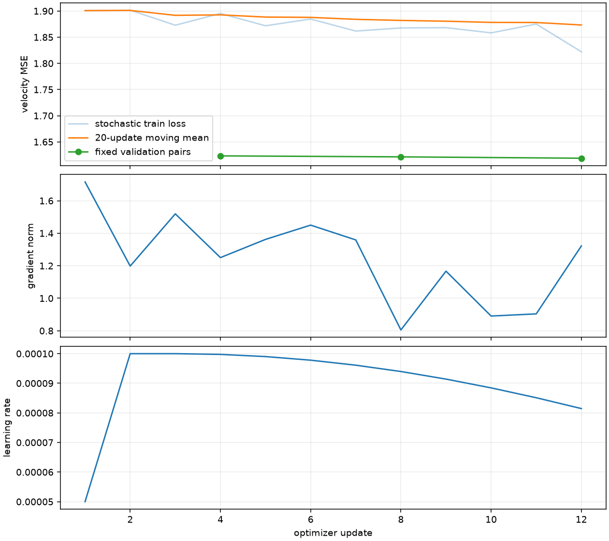
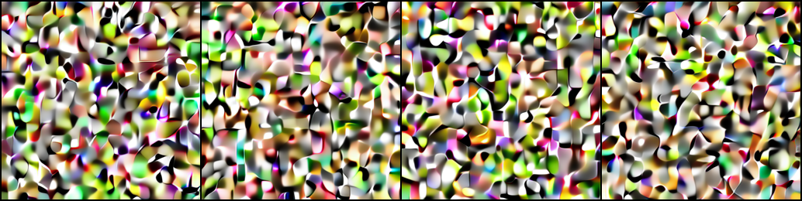
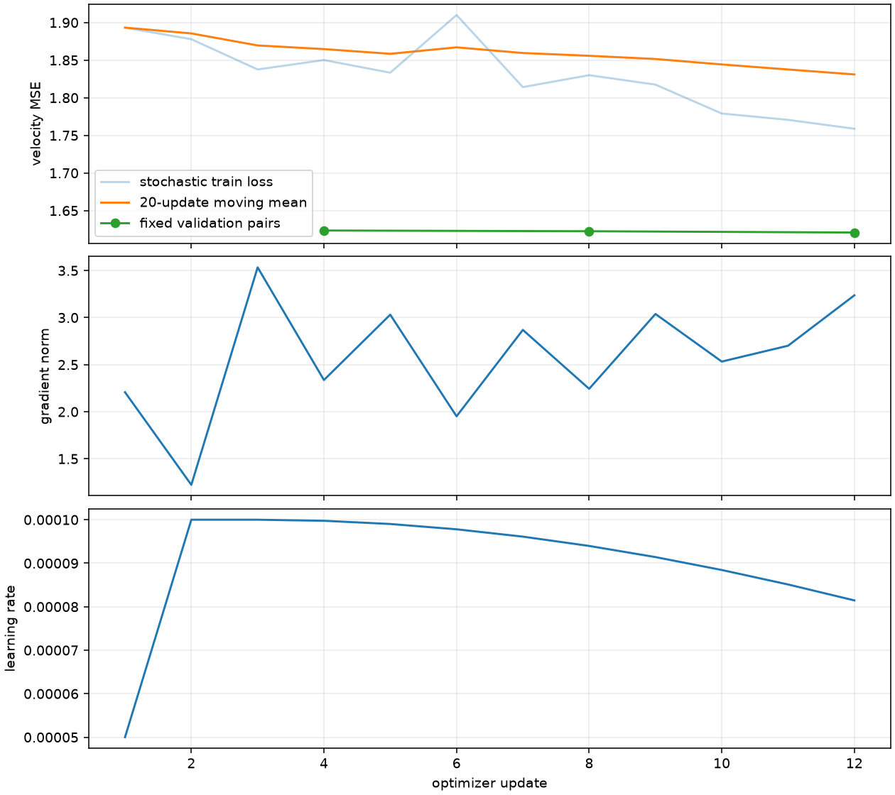

## **一、实验范围与实际配置**

本报告记录 2026-11-10 本机 Apple M5、24GB 统一内存、Python 3.12.14 / PyTorch 2.14.1 的真实运行。三个正式约 30M 主干均使用 MPS FP32，同一组 4 张训练数据、另取验证集 4 张，来自已经冻结的 ArtBench 缓存；未读取测试集、未重新编码缓存。训练配置在 `configs/training/p4_{b0,b1,b2}_local.json` 与对应 `resume.json`。

每模型先 8 步，再从 `last.pt` 继续 4 步；microbatch=2、gradient_accumulation=2、有效 batch=4，seed=0、LR=1e-4、warmup=2、schedule_steps=32、EMA=0.99、条件丢弃=0.1。实际每模型累计处理 48 个样本访问，不是 48 张不同图片。检查点含第 4 步快照与最终第 12 步。图文投影和主干随机初始化；VAE/CLIP 不训练。

## **二、真实结果与统计口径**

| 模型 | 累计训练循环秒数 | 首步 → 末步随机训练 MSE | 独立固定验证 MSE（EMA） | 更新期间样本/秒 | 4 图去噪秒数 |
| --- | ---: | ---: | ---: | ---: | ---: |
| B0 | 7.542 | 1.900761 → 1.822146 | 1.584985 | 9.540 | 0.200 |
| B1 | 6.621 | 1.893260 → 1.758840 | 1.586916 | 11.038 | 0.521 |
| B2 | 5.751 | 1.893260 → 1.763691 | 1.586911 | 14.776 | 0.340 |

循环时间包含循环内验证与周期保存，不含每次命令启动、组件加载和最终保存全部开销；12 个子进程（每架构训练/恢复/采样/验证）整轮墙钟约 132.0 秒。更新吞吐含取数和同步，不含验证/保存，未预热；4 图去噪使用 EMA、Euler8、CFG1（8 次模型调用）、seed=20261110，仅供可运行性证据。时间不能当成 GPU 性能或架构质量排名。不同架构随机初始化消耗不同 RNG，不能把 12 步随机损失之差解释为因果架构收益。

三组输出皆为噪声纹理，无可辨主体；主 Agent 查看了三张四图拼图、P3 八图诊断及训练日志。这是预先限定的工程烟测，不符合正式艺术生成质量验收，也不证明条件语义已学会。MPS 分段续训成功不等于已独立验证逐位轨迹一致；后者由 CPU 三模型小案例检查。

### **1. CPU/MPS 数值对照**

读取相同第 12 步在线权重和两条缓存样本，时间为 0.2/0.8，种子 20261110，CPU FP32 参考。逐输出与逐参数梯度采用预设 `atol=rtol=2e-4`，没有根据结果调宽阈值。

| 模型 | 输出最大绝对误差 | 梯度最大绝对误差 | 结果 |
| --- | ---: | ---: | --- |
| B0 | 1.043e-07 | 2.049e-08 | passed |
| B1 | 1.341e-07 | 2.755e-08 | passed |
| B2 | 1.192e-07 | 2.154e-08 | passed |

## **三、曲线与全部烟测样本**

### **1. B0**





[训练结果](b0_result.json) · [运行身份](b0_run.json) · [第 8 步结果](b0_step8_result.json) · [逐步日志](b0_metrics.jsonl) · [采样清单](b0_samples.json) · [验证](b0_validation.json) · [设备对照](b0_device_comparison.json)

### **2. B1**




[训练结果](b1_result.json) · [运行身份](b1_run.json) · [第 8 步结果](b1_step8_result.json) · [逐步日志](b1_metrics.jsonl) · [采样清单](b1_samples.json) · [验证](b1_validation.json) · [设备对照](b1_device_comparison.json)

### **3. B2**


[训练结果](b2_result.json) · [运行身份](b2_run.json) · [第 8 步结果](b2_step8_result.json) · [逐步日志](b2_metrics.jsonl) · [采样清单](b2_samples.json) · [验证](b2_validation.json) · [设备对照](b2_device_comparison.json)

## **四、可复制的本地命令**

从仓库根执行，现有目录不会覆盖。重新训练时先复制配置并为 local/resume 同时设置新的 `output_dir`；保持配方一致，sample/evaluate 也需新输出目录。以下展示已执行命令的 B1 形式，B0/B2 分别替换文件名和路径即可，三个架构均实际执行过。

```bash
uv run --locked --offline --no-sync minigen train --config configs/training/p4_b1_local.json --device mps
uv run --locked --offline --no-sync minigen train --config configs/training/p4_b1_resume.json --resume artifacts/runs/p4_b1_local/last.pt --device mps
uv run --locked --offline --no-sync minigen sample --config configs/training/p4_b1_resume.json --checkpoint artifacts/runs/p4_b1_local/last.pt --output artifacts/runs/p4_b1_local/samples --device mps --count 4 --steps 8 --seed 20261110
uv run --locked --offline --no-sync minigen evaluate --config configs/training/p4_b1_resume.json --checkpoint artifacts/runs/p4_b1_local/last.pt --output artifacts/runs/p4_b1_local/validation.json --device mps --count 4 --seed 20261110
uv run --locked --offline --no-sync python scripts/check_flow_device.py --config configs/training/p4_b1_resume.json --checkpoint artifacts/runs/p4_b1_local/last.pt --device mps --output artifacts/runs/p4_b1_local/device_comparison.json
uv run --locked --offline --no-sync python scripts/plot_flow_run.py --run artifacts/runs/p4_b1_local --output artifacts/runs/p4_b1_local/curve.png
```

实际子进程使用同一项目 `.venv/bin/python`，未联网同步环境；上述 uv 形式等价使用该已安装锁定环境。完整 stdout/stderr 位于 `artifacts/runs/p4_baseline/`；主干检查点和逐张 PNG 位于各 `artifacts/runs/p4_*_local/`，不提交 Git。报告中的 samples.json 是原始回执副本，其逐图相对路径相对于回执 `output` 指定的原采样目录；本报告单独链接已提交拼图，不假装逐图原始文件也进入 Git。

## **五、限制与下一步**

P3 单样本和 16 图诊断独立记录在 [收尾报告](../03_p3_closeout.md)。正式三模型的长训、质量对比、条件可靠性与云端开销均未完成。当前测试支持 P5 复用工程入口，不能支持选择最优架构或宣称生成质量提升。CUDA、AMP 和多卡分别按 [云端清单](cloud_readiness.md) 处理，等待用户授权后再进入下一阶段。
